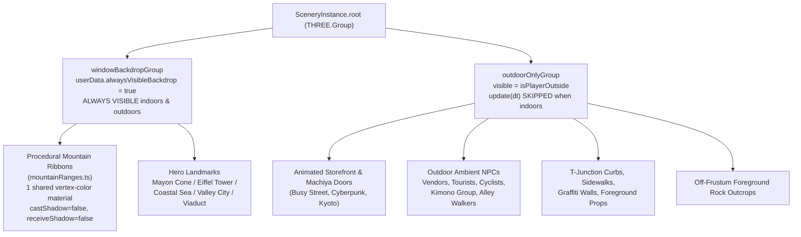
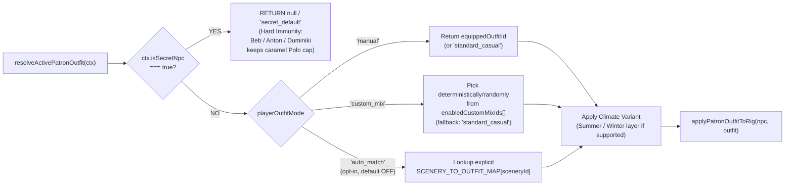
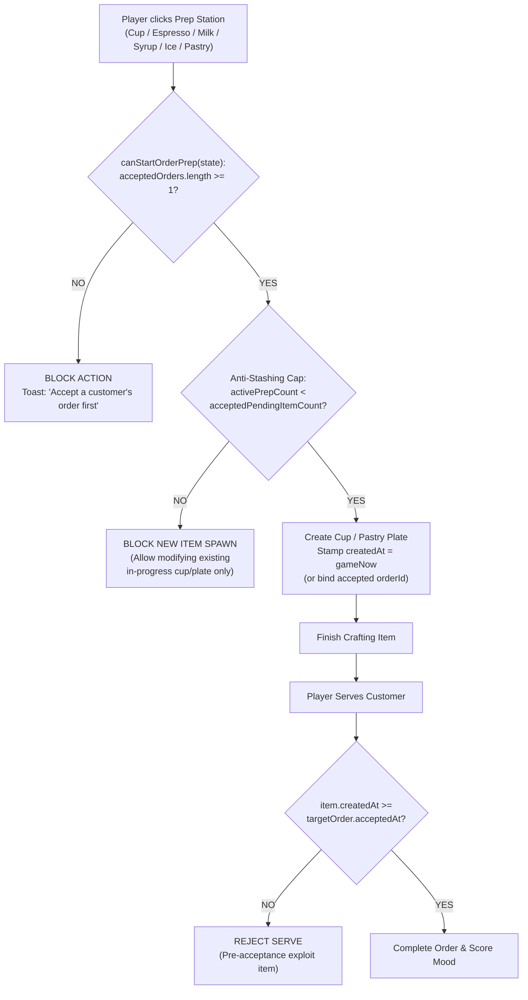
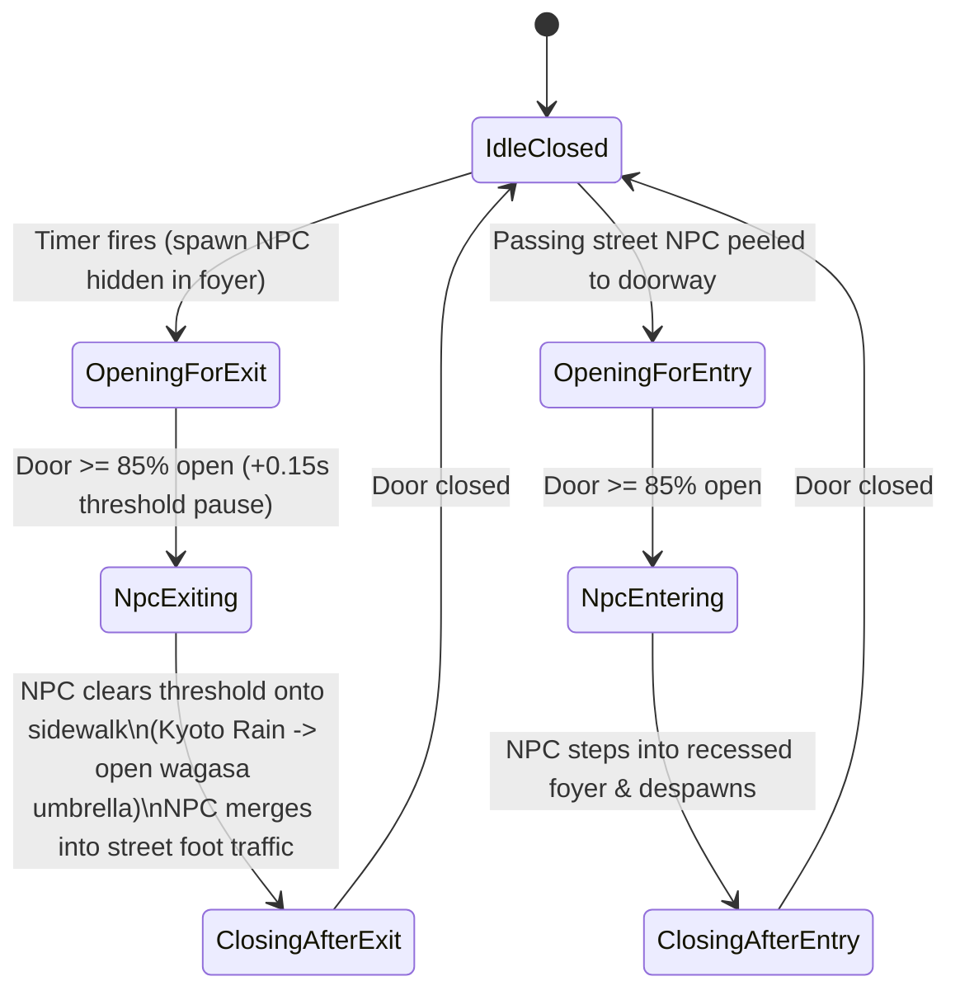
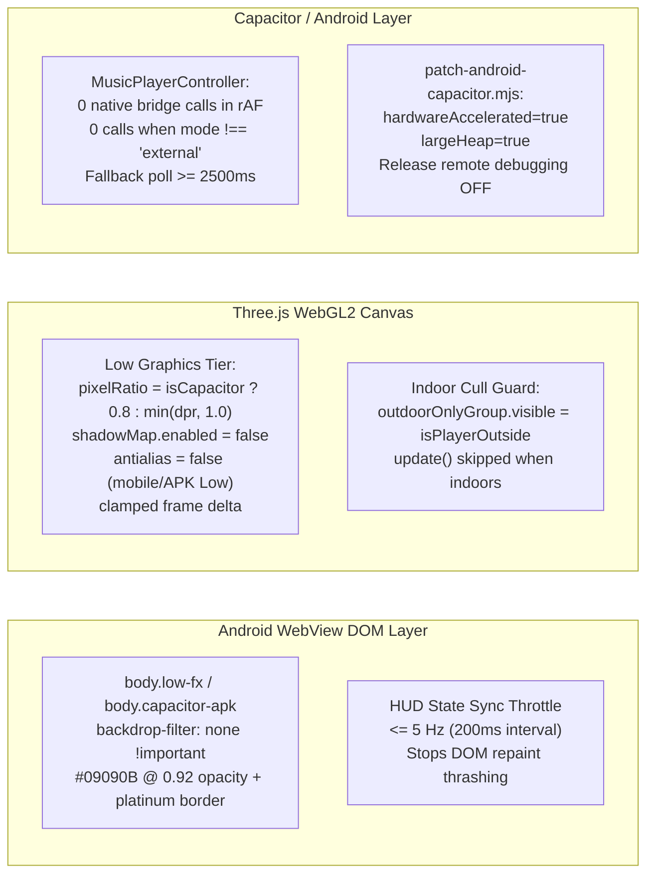

# Klasik 3D — Extended Detail Polish & Optimization Blueprint (`detail polish continuation extended.md`)

> **Target Repo:** `BoostedByCaffeine/Klasik3D`
> **Stack:** TypeScript, Three.js, WebGL2, React/Vite, Capacitor Android APK
> **Primary Files:**
> - **Rules & Tests:** `src/game/rules.ts`, `src/game/rules.test.ts`
> - **Core Scene & Characters:** `src/game/scene3d.ts`, `src/game/patronOutfits3d.ts`, `src/game/outdoorLod.ts`
> - **Scenery Architecture:** `src/game/sceneries/SceneryManager.ts`, `src/game/sceneries/sceneryTypes.ts`, `src/game/sceneries/surroundingContext.ts`, `src/game/sceneries/mountainRanges.ts` *(NEW)*, `src/game/sceneries/sceneriesPart1.ts`, `src/game/sceneries/sceneriesPart2.ts`
> - **UI, CSS, Audio & Android Build:** `src/components/CustomizeModal.tsx` (or `BizUpgradesModal.tsx`), `src/App.tsx` (or `HudOverlay.tsx`), `src/index.css`, `src/game/MusicPlayerController.ts`, `scripts/patch-android-capacitor.mjs`, `.gitignore`

---

## 0. Coding Agent Execution Protocol (Token-Saver Guardrails)

Follow these rules strictly to avoid exploratory token burn, regressions, or redundant file scans:

1. **Execute strictly one Phase at a time** (Phase 1 → Phase 6). Do not touch files outside the active Phase's **File Scope**.
2. **Never break existing world anchors:** When upgrading mountains, roads, or doorways, keep cafe interior coordinates, parked 1990 Mazda Miata MX-5 coordinates, and `Scenic Overlook` camera framing intact unless explicitly specified.
3. **Mandatory Performance Invariant:**
   - Every outdoor-only NPC, vendor, cyclist, kimono walker, alley walker, animated building door, and off-frustum rock outcrop **MUST** be parented under `outdoorOnlyGroup` and skipped inside `update(dt)` when `isPlayerOutside === false`.
   - Every distant horizon landmark and procedural mountain ribbon visible through cafe windows **MUST** live inside `windowBackdropGroup` with `userData.alwaysVisibleBackdrop = true`.
4. **End-of-Phase Verification Gate:** Run `npx tsc --noEmit && npm test && npm run build` at the end of every phase before advancing. Fix errors immediately; do not carry broken types into the next phase.

### Scene Graph & Culling Architecture (Reference Map)



### File Ownership Matrix (Quick Lookup)

| Domain | Files to Modify | Do NOT Break |
| :--- | :--- | :--- |
| **APK & CSS Perf** | `src/index.css`, `src/game/MusicPlayerController.ts`, `src/game/scene3d.ts`, `src/App.tsx`, `scripts/patch-android-capacitor.mjs` | `#09090B` obsidian theme, platinum borders, Spotify/external audio toggle |
| **Rules & Anti-Exploit** | `src/game/rules.ts`, `src/game/rules.test.ts`, `src/App.tsx`, `src/game/scene3d.ts` | Existing recipe definitions, pricing, day-cycle math |
| **Outfits & Secret NPC** | `src/game/rules.ts`, `src/game/patronOutfits3d.ts`, `src/game/scene3d.ts`, `CustomizeModal.tsx` | Secret NPC (`Beb` / `Anton` / `Duminiki`) caramel Polo cap & custom rig |
| **Cats & Delivery Rider** | `src/game/scene3d.ts` | All 12 cat rigs (Champy, Lilo, Amby, Gigi, Tisay, etc.), delivery path timing |
| **Roads & Doors** | `surroundingContext.ts`, `outdoorLod.ts`, `sceneriesPart1.ts`, `sceneriesPart2.ts`, `scene3d.ts` | `evaluateCornerTurnPath` lane centering, downhill Paris T-branch |
| **Mountain Ranges** | `src/game/sceneries/mountainRanges.ts` *(NEW)*, `sceneriesPart1.ts`, `sceneriesPart2.ts`, `SceneryManager.ts` | Mayon stratovolcano cone, Switzerland viaduct portals & funicular lodges, Everest Base Camp |

---

## 1. Gameplay Rules, Anti-Exploit Guards & Core Character Systems

### 1.1 Cold-Climate Drink Ordering Rule (`switzerland_hilltop` & `mt_everest`)
**Files:** `src/game/rules.ts`, `src/game/rules.test.ts`

```ts
export interface DrinkTempBias {
  hotWeight: number;  // 0.0 - 1.0
  icedWeight: number; // 0.0 - 1.0
}

export function getSceneryDrinkTempBias(sceneryId: string): DrinkTempBias {
  if (sceneryId === 'switzerland_hilltop' || sceneryId === 'mt_everest') {
    return { hotWeight: 0.95, icedWeight: 0.05 };
  }
  return { hotWeight: 0.5, icedWeight: 0.5 }; // preserve existing default ratio if non-50/50
}
```

- Inject `getSceneryDrinkTempBias(activeSceneryId)` into customer drink selection so cold alpine/Himalayan sceneries roll **95% Hot / 5% Iced** (rare novelty order).
- **Tests (`rules.test.ts`):** Run a deterministic RNG sample (e.g., `N = 2000`) for both `'switzerland_hilltop'` and `'mt_everest'`. Assert:
  - `hotRatio >= 0.90`
  - `icedRatio > 0 && icedRatio <= 0.10`
  - Non-cold sceneries retain balanced default ratios.

---

### 1.2 Manual Patron NPC Outfit Control & Secret NPC Easter Egg Immunity
**Files:** `src/game/rules.ts`, `src/game/patronOutfits3d.ts`, `src/game/scene3d.ts`, `src/components/CustomizeModal.tsx` (or `BizUpgradesModal.tsx`), `src/game/rules.test.ts`

#### Outfit Resolution Pipeline



#### Explicit Implementation Specs
1. **Default Behavior:** `autoMatchScenery` is **OFF by default**. Players can:
   - **Manual Single Equip:** Select any unlocked patron outfit pack or `Standard Casual`—applied to **both** indoor customers and outdoor pedestrians regardless of active scenery.
   - **Custom Mix:** Toggle 2+ unlocked outfits into a randomized spawn pool.
   - **Optional Auto-Match:** Opt-in toggle using an explicit, verified `Record<SceneryId, PatronOutfitId>` covering all 9 sceneries.
2. **Double-Layer Secret NPC Immunity:**
   - **Layer 1 (`rules.ts` / `scene3d.ts`):** Tag secret NPC descriptors and spawned entities with `isSecretNpc: true` (`Beb`, `Anton`, `Duminiki`). Short-circuit `resolveActivePatronOutfit()` at line 1 when `context.isSecretNpc === true`.
   - **Layer 2 (`patronOutfits3d.ts`):** At line 1 of `applyPatronOutfitToRig(npc, outfit)`:
     ```ts
     if (npc.userData?.isSecretNpc === true) return;
     ```
     This guarantees headwear, torso meshes, and material swaps can never overwrite the caramel Polo cap or signature attire indoors or outdoors.
3. **Unit Tests (`rules.test.ts`):**
   - Verify Manual Single Equip ignores active scenery.
   - Verify Custom Mix only returns outfits inside the player's selected pool.
   - Verify Auto-Match resolves accurately across all 9 sceneries.
   - Verify `isSecretNpc: true` returns the unaltered immunity bypass across **all 3 modes** (`manual`, `custom_mix`, `auto_match`) and **all 9 sceneries**.

---

### 1.3 Close Pre-Acceptance Order Crafting & Mood Timer Bypass Exploit
**Files:** `src/game/rules.ts`, `src/game/scene3d.ts`, `src/App.tsx` (or `HudOverlay.tsx`), `src/game/rules.test.ts`

#### Two-Layer Anti-Exploit State Machine



#### Exact TypeScript Guards (`src/game/rules.ts`)

```ts
export interface OrderPrepGuardState {
  acceptedOrders: Array<{ id: string; acceptedAt: number; pendingItemCount: number }>;
  activePrepCount: number; // total unserved in-progress cups + pastry plates on counter
}

export function canStartOrderPrep(state: OrderPrepGuardState): { allowed: boolean; reason?: 'no_accepted_order' | 'slot_cap_reached' } {
  if (state.acceptedOrders.length === 0) {
    return { allowed: false, reason: 'no_accepted_order' };
  }
  const acceptedPendingItemCount = state.acceptedOrders.reduce((sum, o) => sum + o.pendingItemCount, 0);
  if (state.activePrepCount >= acceptedPendingItemCount) {
    return { allowed: false, reason: 'slot_cap_reached' };
  }
  return { allowed: true };
}

export function canServePreparedItem(itemCreatedAt: number, orderAcceptedAt: number): boolean {
  return itemCreatedAt >= orderAcceptedAt;
}
```

- **Important Nuance:** `slot_cap_reached` blocks spawning a **new** cup/glass/pastry plate (preventing pre-stashing for Customer #2 while Customer #1 is accepted), while still allowing the player to add espresso/milk/syrup/ice into an **already-spawned** cup.
- **UI Hardening (`App.tsx` / `HudOverlay.tsx`):** Keep unaccepted customers in a `"Ready to order"` prompt state; reveal the exact recipe breakdown only after clicking **Accept** so the mood countdown and crafting window always start together.
- **Tests (`rules.test.ts`):** Cover `0` accepted orders -> `false`, `1` accepted order with `activePrepCount < pending` -> `true`, `activePrepCount === pending` -> `false` (`slot_cap_reached`), and `canServePreparedItem(100, 150) === false` vs `canServePreparedItem(150, 150) === true`.

---

### 1.4 Sleeping Cat Closed-Eyes Fix
**File:** `src/game/scene3d.ts`

#### Cat Eye Rig Hierarchy & Visibility Truth Table

```text
catHeadGroup
 ├── openEyeGroup (or individual meshes)
 │    ├── leftEye / leftIris / leftPupil / leftCatchlight
 │    └── rightEye / rightIris / rightPupil / rightCatchlight
 └── closedEyeGroup  <-- ADD FLUSH ACROSS EYE SOCKETS (+0.004 Z forward bias to avoid z-fighting)
      ├── closedEyeL (sleek downward-curved dark arc / TorusGeometry arc)
      └── closedEyeR (sleek downward-curved dark arc / TorusGeometry arc)
```

| Cat Animation State | Open Eye / Iris / Pupil / Catchlight | `closedEyeL` & `closedEyeR` |
| :--- | :---: | :---: |
| `idle` / `walking` / `grooming` / `eating` | `visible = true` | `visible = false` |
| Periodic awake blink (`~0.14s` pulse) | `visible = false` | `visible = true` |
| `'sleeping'` (curled posture) | `visible = false` | `visible = true` |
| Instant wake (pet / feed / comb) | `visible = true` (immediate) | `visible = false` (immediate) |

- Verify all **12 cats** (Champy, Lilo, Amby, Gigi, Tisay, etc.) share the same `setCatEyesClosed(catRig, isClosed: boolean)` helper so no individual cat keeps floating pupils or specular highlights when curled asleep.

---

### 1.5 Scenery-Specific Delivery Rider Vehicles
**File:** `src/game/scene3d.ts`

Build a single `syncDeliveryRiderVehicle(sceneryId)` swapper toggling three pre-built or cleanly disposed sub-groups on the delivery rider rig:

| Active Scenery | Vehicle Variant | Procedural Geometry Spec | Animation Channels (`update`) |
| :--- | :--- | :--- | :--- |
| `japanese_tranquility` | **Classic Japanese Delivery Bicycle** (*no scooters*) | Slender dark steel diamond frame (`CylinderGeometry` tubes), 2 thin tires + spinning spoke groups, curved handlebars + tiny brass bell, rear wooden/insulated Klasik coffee crate | Spin front/rear wheels proportional to linear speed (`v / wheelRadius`); alternate rider upper/lower legs in pedaling sine cycle |
| `cyberpunk_neon` | **Floating Hover-Scooter** (*zero wheels*) | Sleek matte-obsidian chassis (`#111318`), cyan (`#00F0FF`) & magenta (`#FF2A85`) emissive trim strips, 2 glowing under-thruster discs, subtle additive rear neon light trail | Hover bob `y = baseHoverY + Math.sin(t * 4.5) * 0.06`, slight forward pitch on acceleration, thruster emissive pulse |
| All other 7 sceneries | **Standard Delivery Scooter** | Existing scooter geometry untouched | Existing wheel spin & lean |

---

## 2. Global T-Junction Road Geometry & Animated Building Entry/Exit System

### 2.1 Fix Roads Expanding Into End-of-Road Buildings
**Files:** `src/game/sceneries/surroundingContext.ts`, `src/game/sceneries/sceneriesPart1.ts`, `src/game/sceneries/sceneriesPart2.ts`, `src/game/outdoorLod.ts`

**Applies to:** `brazilian_favela`, `cyberpunk_neon`, `busy_street`, `eiffel_tower_view`.

#### Top-Down T-Intersection Blueprint (Must Match on BOTH `-X` and `+X` Ends)

```text
         -X END BUILDING                          CAFE SIDE (-Z)                          +X END BUILDING
   ┌─────────────────────────┐                                                      ┌─────────────────────────┐
   │  End-of-Road Facade     │   (Favela: Rio Graffiti Mural on BOTH ends)          │  End-of-Road Facade     │
   │  (Haussmann / Favela /  │   (Eiffel: Flush Mansard Roof roofY = wallTopY)      │                         │
   │   Cyber / Busy Street)  │                                                      │                         │
   ├─────────────────────────┤                                                      ├─────────────────────────┤
   │ Far-Side Sidewalk       │  <-- width >= 2.6 units, topY = 0.11                 │ Far-Side Sidewalk       │
   │ + Raised Curb (0.11)    │                                                      │ + Raised Curb (0.11)    │
   ╞═════════════════════════╡  <-- |x| = T_JUNCTION_OUTER_EDGE (STRICT ASPHALT END)╞═════════════════════════╡
   │   Perpendicular         │  === Crosswalk ===                  === Crosswalk ===│   Perpendicular         │
   │   Cross-Street          │  │  Stop Line   │   MAIN STREET      │   Stop Line  ││   Cross-Street          │
   │   (N/S Turn Lanes)      │  └──────────────┘   ASPHALT          └──────────────┘│   (N/S Turn Lanes)      │
   │      ▲        │         │        ◄───────────────────────────────────────      │         │        ▲      │
   │      │  turn  ▼         │        ───────────────────────────────────────►      │         ▼  turn  │      │
   ╞═════════════════════════╡                                                      ╞═════════════════════════╡
```

#### Non-Negotiable Geometric Constraints
1. Main street asphalt mesh **MUST terminate strictly** at `|x| = T_JUNCTION_OUTER_EDGE` (the outer curb of the perpendicular cross-street). Zero asphalt may overlap into the far-side sidewalk or building base.
2. Place a **raised curb (`curbTopY = 0.11`) + continuous far-side pedestrian sidewalk (`width >= 2.6`)** between `|x| = T_JUNCTION_OUTER_EDGE` and the end-of-road building front wall on **both `-X` and `+X`**.
3. Paint crisp **perpendicular white stop lines** (`width ~0.28`, `y = 0.015`) and **corner zebra crosswalk stripes** at both T-junctions.
4. Audit `evaluateCornerTurnPath()` so turning cars remain centered within the cross-street lanes with at least `0.6` units clearance from the new far-side curb.

---

### 2.2 Animated Building Entrances & Exits (`busy_street`, `cyberpunk_neon`, `japanese_tranquility`)
**Files:** `src/game/sceneries/surroundingContext.ts`, `src/game/sceneries/sceneriesPart1.ts`, `src/game/sceneries/sceneriesPart2.ts`, `src/game/scene3d.ts`

Upgrade **3–4 street-facing storefronts/houses** per scenery from flat box facades into recessed interactive doorways.

#### Door Construction Cross-Section (Top-Down)

```text
          RECESSED INTERIOR FOYER / GENKAN
          (Dark timber/interior box depth >= 1.4u
           warm lantern glow for Kyoto dusk/night)
         ┌────────────────────────────────┐
         │      [NPC spawn/despawn]       │
  ───────┘          ▲        │            └───────  Building Front Wall
     Door Frame ────┤  Door  ├──── Door Frame
                    │ Plane  │  <-- Z-offset +0.02 clearance (zero z-fighting)
                    ▼        │
               SIDEWALK / STONE STREET
```

#### Door Animation Specifications by Scenery

| Scenery | Door Style | Kinematics & Timing | Interior Depth & Extras |
| :--- | :--- | :--- | :--- |
| `busy_street` | **Hinged wood/glass shop door** | `doorPivot.rotation.y`: `0° → 82° → 0°` (smooth ease-in-out, `0.35s` open / `0.40s` close) | Dark recessed foyer behind frame so open door reveals real depth |
| `cyberpunk_neon` | **Split sliding glass/metal doors** | `leftPanel.x: 0 → -0.46*W`, `rightPanel.x: 0 → +0.46*W` (`0.32s` smooth slide) | Glowing cyan/amber frame status strip (switches color while open) + dark lit cyber vestibule |
| `japanese_tranquility` | **Kyoto *machiya* sliding *hikido* / *shoji* door** | Single or split lattice panel in dark-cedar `kamoi`/`shikii` tracks; `panel.x: 0 → 0.82 * doorWidth` into wall pocket; cubic ease-in-out (`0.45s` open / `0.50s` close) | Translucent *washi* paper with warm emissive glow at dusk/night; recessed ***genkan*** (dark timber floor, raised step, warm interior lantern bounce); share cedar/washi geometries & materials across all upgraded townhouses |

#### Outdoor NPC Doorway State Machine (Skipped when `isPlayerOutside === false`)



- All animated door groups, recessed foyers, and spawned NPCs MUST reside inside `outdoorOnlyGroup`.
- All spawned NPCs MUST pass through `resolveActivePatronOutfit()` (retaining Secret NPC immunity).

---

## 3. Procedural Mountain Range Optimization & Scenery-by-Scenery Visual Fixes

### 3.0 Shared Procedural Mountain Range Builder (`src/game/sceneries/mountainRanges.ts`) — NEW MODULE
**Files:** `src/game/sceneries/mountainRanges.ts`, `src/game/sceneries/sceneriesPart1.ts`, `src/game/sceneries/sceneriesPart2.ts`, `src/game/sceneries/SceneryManager.ts`

Replaces sharp `ConeGeometry` "party-hat" mountains across **Switzerland Hilltop**, **Mayon Volcano** *(surrounding hills only — Mayon itself stays untouched)*, **Hilltop City Lights**, and **Mt. Everest**.

#### Cross-Section & Grounding Blueprint (Zero Floating Edges)

```text
                       /\    <-- Asymmetric non-zero summit crest (no needle point)
                     _/  \__     Sculpted via ridged noise: 1 - Math.abs(fbm2D(x, z))
                   _/  /\   \
                 _/   /  \   \__   <-- Steep face: rock/granite vertex color
               _/    /    \     \__    Gentle high face: noise-warped snow vertex color
  ════════════/═════/══════\═══════\══════════  y = 0 (Valley / Sea / Lake Surface)
             │                      │
             │   VERTICAL SKIRT     │  <-- Outer base ring dropped straight to skirtFloorY
             │   (open-bottom)      │      Hilltop: y = -24  |  Switzerland: y = -30
             ▼                      ▼  <-- Zero bottom cap triangles (THREE.FrontSide)
```

#### Exact TypeScript Interfaces & Algorithm Spec (`mountainRanges.ts`)

```ts
export type GraphicsTier = 'low' | 'medium' | 'high';

export interface MountainBiomePalette {
  baseColor: number;       // Foothill forest / scree / coastal foliage
  midRockColor: number;    // Mid-elevation granite / volcanic rock
  steepCliffColor: number; // Exposed dark cliff where snow sheds off
  snowColor: number;       // High-altitude gentle-slope snow cap (optional if snowline > 1)
  snowlineNormalized: number; // 0.0 - 1.2 (>1.0 disables snow, e.g. Mayon/Hilltop)
  steepnessRockThreshold: number; // e.g. 0.52 (normal.y < threshold forces rock)
}

export interface RidgedPeakOptions {
  seed: number;
  radiusX: number;
  radiusZ: number;
  height: number;
  baseY: number;
  skirtFloorY: number;      // e.g. -24 (Hilltop), -30 (Switzerland)
  ridgeStretch?: number;    // 0.15 - 0.45 elongates apex into a natural crest
  palette: MountainBiomePalette;
  tier: GraphicsTier;
}

export interface MountainRangeRibbonOptions {
  seed: number;
  arcRadius: number;        // Distance from scene center
  startAngle: number;       // Radians
  endAngle: number;         // Radians
  depth: number;            // Front-to-back thickness of range
  peakCount: number;        // 3 - 5 connected peaks + saddles
  minPeakHeight: number;
  maxPeakHeight: number;
  baseY: number;
  skirtFloorY: number;
  palette: MountainBiomePalette;
  tier: GraphicsTier;
}
```

#### Deterministic Noise, Vertex Coloring & LOD Budget
1. **Seeded Ridged FBM:** Use a fast, deterministic 2D hash/value-noise function (seeded by `options.seed`) with 3 octaves:
   - `ridge(x, z) = 1.0 - Math.abs(noise2D(x, z) * 2.0 - 1.0)`
   - Square the ridge (`ridge * ridge`) for crisp alpine/Himalayan arêtes; leave linear for soft rolling tropical Bicol foothills.
2. **Vertex Color Baking (`vertexColors: true`, `flatShading: true`):**
   - Call `geometry.computeVertexNormals()` after vertex displacement.
   - For each vertex: compute normalized elevation `hNorm = clamp((y - baseY) / maxHeight, 0, 1)` and slope flatness `upDot = normal.y`.
   - Blend `baseColor -> midRockColor` by `hNorm`. If `upDot < palette.steepnessRockThreshold`, blend strongly toward `steepCliffColor`. If `hNorm + noiseOffset > palette.snowlineNormalized` AND `upDot >= palette.steepnessRockThreshold`, blend to `snowColor`.
3. **Shared Material & Zero Shadow Cost:**
   - Export `createSharedMountainMaterial()` returning **one** `MeshLambertMaterial({ vertexColors: true, flatShading: true, side: THREE.FrontSide })` per scenery so `batchStaticMeshesByMaterial()` merges everything cleanly.
   - Always set `mesh.castShadow = false; mesh.receiveShadow = false;` on distant mountain meshes.
4. **Graphics-Tier Triangle Budget:**
   - `tier === 'low'` (Android APK / Mobile Low): Ribbon `widthSegments = 20..24`, `depthSegments = 4..5` (`~140–200` triangles per full multi-peak range ribbon).
   - `tier === 'medium' | 'high'` (PC): Ribbon `widthSegments = 32..38`, `depthSegments = 6..8` (`~300–450` triangles per ribbon).

#### Biome Palette Lookup Table

| Scenery | Preset Name | `baseColor` | `midRockColor` | `steepCliffColor` | `snowColor` | `snowlineNormalized` | `skirtFloorY` |
| :--- | :--- | :---: | :---: | :---: | :---: | :---: | :---: |
| **Mayon Foothills** | `MAYON_FOOTHILLS` | `0x2D5A27` | `0x3F6D32` | `0x4A5344` | `0xFFFFFF` | `1.5` (no snow) | `-10` |
| **Hilltop City Lights** | `COASTAL_SIERRA` | `0x263A2E` | `0x3B444B` | `0x2E323A` | `0xFFFFFF` | `1.5` (no snow) | `-24` |
| **Switzerland Hilltop** | `SWISS_ALPINE` | `0x325238` | `0x636B73` | `0x3E444D` | `0xF2F7FC` | `0.56` | `-30` |
| **Mt. Everest** | `HIMALAYAN_HORN` | `0x59626E` | `0x434B57` | `0x252B33` | `0xF5FAFF` | `0.42` | `-26` |

---

### 3.1 Mayon Volcano & Cagsawa Ruins (`sceneriesPart1.ts`, `mountainRanges.ts`)
- **Surrounding Foothills Upgrade (DO NOT TOUCH MAYON VOLCANO):**
  - Replace flanking/background sharp cones with rolling tropical `MAYON_FOOTHILLS` ridge ribbons (`createMountainRangeRibbon`).
  - Leave Mayon Volcano's hero stratovolcano geometry untouched so its real-world symmetrical silhouette dominates the horizon.
- **Souvenir Market Vendors:** Place an animated Bicol vendor behind **every** outdoor souvenir stall (tropical shirts, aprons, woven *salakot*/sun hats; gentle idle sway + arm gesture toward handicrafts/pasalubong). Parent inside `outdoorOnlyGroup`.
- **Higher Tourist Density:** Expand market plaza & Cagsawa belfry tourists (family/friend clusters, camera/phone photo poses aimed at Mayon, chatting pairs, auto rain umbrellas during Rain). Parent inside `outdoorOnlyGroup`.
- **Procedural Textured Road:** Replace flat gray foreground road material with a cached, cleanly disposed `CanvasTexture` asphalt/concrete surface (fine aggregate grain, subtle tire-wear bands, faded lane edges, concrete expansion seams).

### 3.2 Hilltop City Lights (`sceneriesPart1.ts`, `mountainRanges.ts`)
- **Coastal Sierra Ridges + Zero Floating Edges:** Replace left-side cone and distant ridge cones with `COASTAL_SIERRA` ribbons/peaks using `skirtFloorY <= -24`.
- **Expansive Shimmering Coastal Sea / Bay:** Replace empty valley/horizon void with a large low-poly reflective ocean plane extending cleanly into horizon fog:
  - **Sunset:** Warm gold/orange specular tint.
  - **Night:** Deep moonlit navy with subtle warm city-light reflection glints.
- Keep grounded valley metropolis and highland terrace completely intact.

### 3.3 Japanese Tranquility (`sceneriesPart1.ts`, `surroundingContext.ts`, `scene3d.ts`)
- **Cycling NPCs (`outdoorOnlyGroup`):** Spawn 2–3 Kyoto cyclists on *mamachari* bicycles (spinning spoked wheels, front basket, pedaling legs) gliding along the stone street and turning cleanly at both T-intersections.
- **Kimono Girls Group (`outdoorOnlyGroup`):** Spawn a strolling cluster of 2–3 kimono walkers (floral/patterned *kimono* silhouettes, contrasting *obi* waist sashes, hair buns with *kanzashi* pins, automatic paper *wagasa* umbrellas in Rain).
- **Animated *Machiya* Sliding Doors (`outdoorOnlyGroup`):** Upgrade 3–4 street-facing *machiya* townhouses per Section 2.2 (sliding *hikido*/*shoji* doors + warm recessed *genkan* + exiting/entering outdoor NPCs).
- **Bicycle-Only Delivery Rider:** Enforce Section 1.5 bicycle override whenever `japanese_tranquility` is active.

### 3.4 Brazilian Favela — Rio de Janeiro View (`sceneriesPart1.ts`)
- **True T-Intersection Fix:** Apply Section 2.1 on both `-X` and `+X` ends.
- **Favela-Exclusive End-of-Road Graffiti Murals:** Replace solid flat teal/plain walls on **both `-X` and `+X` end-of-road buildings** with vibrant procedural `CanvasTexture` Rio street-art murals (brick base texture + bold geometric color blocks + tropical leaf/toucan motifs + stylized graffiti lettering; cached & disposed cleanly).
- **Stepped Downhill Alley Walkers (`outdoorOnlyGroup`):** Add 2–3 stepped hillside alleyways between foreground favela houses and animate outdoor NPCs descending/ascending onto the main sidewalk using grounded step-height interpolation (`y = interpolateAlleyStepY(t)`).

### 3.5 Cyberpunk Neon (`sceneriesPart2.ts`, `scene3d.ts`)
- **True T-Intersection Fix:** Apply Section 2.1 for ground lanes while keeping aerial hover-cars banking smoothly overhead.
- **Active Outdoor Kiosks & Vendors (`outdoorOnlyGroup`):** Add street-level lit stalls (Holo Ramen counter, Cyber-Boba/Synth-Drink stall, Street Tech/Chip booth) with animated NPC vendors tending each counter, glowing emissive menu boards, and rising lightweight steam wisps.
- **Alley Walkers & Sliding Storefront Doors (`outdoorOnlyGroup`):** Spawn cyber-pedestrians emerging from neon side alleys + Section 2.2 split sliding doors.
- **Hover-Scooter Delivery Rider:** Enforce Section 1.5 floating hover-scooter override.

### 3.6 Eiffel Tower View (`sceneriesPart2.ts`, `surroundingContext.ts`)
- **Flush Haussmann Corner Mansard Roofs Fix:**
  ```text
  BEFORE (Bug):  [  Roof Floating / Offset  ]     AFTER (Fix):  ┌──────────────────┐
                                                                │  Mansard Roof    │ <-- roofBaseY === wallTopY
                    ┌──────────────────┐                        ├──────────────────┤     same X, Z, width, depth, yaw
                    │  Corner Wall     │                        │  Corner Wall     │
  ```
  Audit both `-X` and `+X` end-of-road Haussmann corner buildings and snap dark slate mansard roofs strictly flush onto `wallTopY` with matching center `(x, z)`, footprint `(w, d)`, and `rotation.y`.
- **T-Intersection + Vista Protection:** Apply Section 2.1 curb/sidewalk termination while preserving the downhill T-branch toward Paris and keeping `Scenic Overlook` unobstructed by foreground vehicles.

### 3.7 Switzerland Hilltop (`sceneriesPart2.ts`, `mountainRanges.ts`)
- **Procedural Alpine Massifs:** Replace left, center, and right cones with `SWISS_ALPINE` massifs/ribbons (`skirtFloorY <= -30`). Preserve exact terrain clearance around viaduct portals and lodge foundations.
- **Viaduct Bridge Structural Grounding:**
  ```text
  [Rocky Embankment + Stone Tunnel Portal]══╤══╤══╤══╤══[Rocky Embankment + Stone Tunnel Portal]
     (Seated deep into -X mountainside)     │  │  │  │     (Seated deep into +X mountainside)
  ```
  Extend both bridge ends solidly into sculpted rock embankments / recessed tunnel portals—never terminating in mid-air or open water.
- **Funicular / Aerial Gondola + Dual Timber Lodges:**
  - Delete stray disconnected inclined gray/white slab and unanchored floating poles.
  - Build **2 grounded Swiss Alpine Timber Lodges / Stations** (lower + upper endpoints: warm lit windows, snow-dusted pitched chalet roofs, stone deck foundations seated deeply into the hillside).
  - Anchor the cable/track cleanly between both lodges with sturdy steel support pylons grounded into the terrain slope.
- **Hot-Drink Bias:** Apply Section 1.1 (`95%` hot / `5%` iced).

### 3.8 Mt. Everest & Hiker Trail (`sceneriesPart2.ts`, `mountainRanges.ts`)
- **Himalayan Horns & Serrated Arêtes:** Replace flanking cones with broad `HIMALAYAN_HORN` pyramidal horns and serrated arête ridges (Everest/Nuptse/Lhotse silhouette) without shifting base camp or summit sightlines.
- **Base Camp Detail Pass (`outdoorOnlyGroup`):**
  - Steaming dark kettle/pot suspended on a 3-leg tripod over the crackling campfire.
  - Weathered multi-arrow wooden trail signpost (`EVEREST SUMMIT 8,848m`, `KALA PATTHAR`, `BASE CAMP`) + stacked expedition gear/sled near dome tents.
  - 1–2 seated/standing hikers warming hands by the fire + subtle low wind-blown snow wisps drifting near the trail.
- **Hot-Drink Bias:** Apply Section 1.1 (`95%` hot / `5%` iced).

---

## 4. Performance Hardening, Android APK Rescue & Repo Hygiene

### 4.1 Android APK (Capacitor WebView) Performance Rescue
**Files:** `scripts/patch-android-capacitor.mjs`, `src/index.css`, `src/game/scene3d.ts`, `src/game/MusicPlayerController.ts`, `src/App.tsx` (or `HudOverlay.tsx`)

#### APK Render & Bridge Optimization Pipeline



1. **CSS Glass-Blur Bypass (`src/index.css`):** Toggle `low-fx` / `capacitor-apk` on `document.body` for Low graphics (and APK Low/Medium):
   ```css
   body.low-fx .hud-glass,
   body.capacitor-apk .hud-glass {
     backdrop-filter: none !important;
     -webkit-backdrop-filter: none !important;
     background-color: rgba(9, 9, 11, 0.92);
   }
   ```
   *(Apply to all existing HUD pill/bar/modal backdrop-blur selectors while preserving `#09090B` obsidian surfaces and crisp platinum borders.)*
2. **Native Audio Bridge (`MusicPlayerController.ts`, `KlasikNativeAudioBridge`):** Zero native bridge calls inside `requestAnimationFrame`; zero polling when Audio Mode `!== 'external'`; throttle fallback external-audio checks to `>= 2500ms`.
3. **WebGL Tuning (`scene3d.ts`):** On Low graphics: `renderer.setPixelRatio(isCapacitor ? 0.8 : Math.min(window.devicePixelRatio, 1.0))`, `renderer.shadowMap.enabled = false`, `antialias: false` on mobile/APK Low, and cap frame `dt` cleanly (e.g., `Math.min(dt, 0.05)`).
4. **Android Manifest Patch (`scripts/patch-android-capacitor.mjs`):** Guarantee `android:hardwareAccelerated="true"` and `android:largeHeap="true"` in `AndroidManifest.xml`, and ensure WebView remote debugging (`setWebContentsDebuggingEnabled`) is disabled in release builds.
5. **HUD Sync Throttle (`App.tsx` / `HudOverlay.tsx`):** Throttle patience bar / clock / non-click React HUD updates to `>= 200ms` (`<= 5 Hz`).

### 4.2 Indoor Framerate Protection & Title Screen Tree Clearance
**Files:** `src/game/sceneries/SceneryManager.ts`, `src/game/sceneries/sceneryTypes.ts`, `src/game/sceneries/mountainRanges.ts`, `src/game/sceneries/sceneriesPart1.ts`, `src/game/sceneries/sceneriesPart2.ts`

- In `SceneryManager.loadScenery()`:
  - Auto-tag `if (instance.windowBackdropGroup) instance.windowBackdropGroup.userData.alwaysVisibleBackdrop = true;` so `applyIndoorBackdropCullFilter()` never hides window-visible landmarks or mountain ribbons.
  - Auto-run `batchStaticMeshesByMaterial(instance.root)` on static non-animated geometry across all 9 sceneries.
- **Mountain Draw-Call Reduction:** Collapse 8–15 individual cone meshes per mountain scenery into **1–2 continuous open-bottom ribbons** sharing one vertex-colored material (~80% draw-call drop). Place window-visible ribbons in `windowBackdropGroup` and off-frustum foreground outcrops in `outdoorOnlyGroup`.
- **Alpine Pine Tree Clearance (Title Screen):** On `hilltop_city_lights`, `switzerland_hilltop`, and `mt_everest`, shift the foreground alpine pine tree right next to the cafe laterally outward (`>= 1.8` units clear of the Miata's bounding box) so pine branches never clip across the parked 1990 Mazda Miata MX-5 windshield on the Title Screen.

### 4.3 Repo Hygiene
- Delete committed `tmp_verify/` screenshot directory (`~6.89 MB`) and append `tmp_verify/` to `.gitignore`.

---

## 5. Phased Execution & Verification Plan (Sequential Agent Checklist)

### Phase 1 — Android APK Performance Rescue, SceneryManager Guard & Repo Hygiene
**File Scope:** `src/index.css`, `src/game/MusicPlayerController.ts`, `src/game/scene3d.ts`, `src/App.tsx`, `scripts/patch-android-capacitor.mjs`, `src/game/sceneries/SceneryManager.ts`, `.gitignore`, `tmp_verify/`
- [ ] Apply `low-fx` / `capacitor-apk` CSS blur bypass preserving `#09090B` (`0.92`) obsidian + platinum border styling.
- [ ] Throttle `MusicPlayerController` / `KlasikNativeAudioBridge` (`>= 2500ms`, zero rAF calls, skipped when not `'external'`).
- [ ] Apply Low-graphics WebGL tuning (`pixelRatio = 0.8` on Capacitor, `shadowMap = false`, `antialias = false`, clamped `dt`) and `<= 5 Hz` (`200ms`) HUD React sync throttle.
- [ ] Update `scripts/patch-android-capacitor.mjs` (`hardwareAccelerated="true"`, `largeHeap="true"`, release remote debugging OFF).
- [ ] Auto-guard `windowBackdropGroup.userData.alwaysVisibleBackdrop = true` and call `batchStaticMeshesByMaterial(instance.root)` in `SceneryManager.loadScenery()`.
- [ ] Remove `tmp_verify/` and add `tmp_verify/` to `.gitignore`.
- [ ] **Phase 1 Gate:** `npx tsc --noEmit && npm test && npm run build` passes cleanly.

### Phase 2 — Gameplay Rules, Anti-Exploit Guards, Patron Outfits, Cats & Delivery Vehicles
**File Scope:** `src/game/rules.ts`, `src/game/rules.test.ts`, `src/game/patronOutfits3d.ts`, `src/game/scene3d.ts`, `src/components/CustomizeModal.tsx`, `src/App.tsx`
- [ ] Implement `getSceneryDrinkTempBias()` (`95%` hot / `5%` iced on `switzerland_hilltop` & `mt_everest`).
- [ ] Implement Manual Single Equip, Custom Mix, and opt-in Auto-Match (`default OFF`) unified in `resolveActivePatronOutfit()`.
- [ ] Enforce double-layer Secret NPC (`Beb`, `Anton`, `Duminiki`) outfit immunity (`isSecretNpc: true` short-circuit in `resolveActivePatronOutfit` and `applyPatronOutfitToRig`).
- [ ] Close pre-acceptance crafting exploit (`canStartOrderPrep`, accepted pending-slot cap, `createdAt >= acceptedAt` serve check, `"Ready to order"` unaccepted UI state, HUD toast).
- [ ] Fix sleeping & blinking closed eyes (`closedEyeL`, `closedEyeR`) across all 12 cats with zero stray open pupils/highlights.
- [ ] Implement `syncDeliveryRiderVehicle()` (Kyoto classic bicycle, Cyberpunk floating hover-scooter, default scooter elsewhere).
- [ ] Add unit tests in `src/game/rules.test.ts` covering all Phase 2 rules & edge cases.
- [ ] **Phase 2 Gate:** `npx tsc --noEmit && npm test && npm run build` passes cleanly.

### Phase 3 — Global T-Junction Curb Fix & Animated Building Entrances/Exits
**File Scope:** `src/game/sceneries/surroundingContext.ts`, `src/game/outdoorLod.ts`, `src/game/sceneries/sceneriesPart1.ts`, `src/game/sceneries/sceneriesPart2.ts`, `src/game/scene3d.ts`
- [ ] Terminate main street asphalt strictly at `|x| = T_JUNCTION_OUTER_EDGE` with `curbTopY = 0.11`, far-side sidewalk (`width >= 2.6`), stop lines, and corner crosswalks on `brazilian_favela`, `cyberpunk_neon`, `busy_street`, and `eiffel_tower_view`.
- [ ] Verify `evaluateCornerTurnPath()` clears the far-side curb cleanly.
- [ ] Implement outdoor animated doors + recessed foyers + NPC entry/exit state machine (inside `outdoorOnlyGroup`) for `busy_street` (hinged), `cyberpunk_neon` (split sliding), and `japanese_tranquility` (Kyoto *machiya* sliding *hikido*/*shoji* + warm *genkan* + Rain *wagasa* umbrellas).
- [ ] **Phase 3 Gate:** `npx tsc --noEmit && npm test && npm run build` passes cleanly.

### Phase 4 — Procedural Mountain Ranges & Scenery Structural Bugfixes
**File Scope:** `src/game/sceneries/mountainRanges.ts` *(NEW)*, `src/game/sceneries/sceneriesPart1.ts`, `src/game/sceneries/sceneriesPart2.ts`, `src/game/sceneries/surroundingContext.ts`
- [ ] Build `src/game/sceneries/mountainRanges.ts` (`createRidgedPeakGeometry`, `createMountainRangeRibbon`, deterministic ridged noise, slope/elevation vertex colors, shared single material, open-bottom `THREE.FrontSide`, `skirtFloorY`, Low/High graphics LOD).
- [ ] **Mayon:** Upgrade surrounding hills to `MAYON_FOOTHILLS` ribbons; keep Mayon Volcano cone untouched.
- [ ] **Hilltop City Lights:** Replace cones with `COASTAL_SIERRA` ribbons (`skirtFloorY <= -24`) + add shimmering coastal sea/bay replacing valley void.
- [ ] **Switzerland Hilltop:** Replace cones with `SWISS_ALPINE` massifs/ribbons (`skirtFloorY <= -30`), anchor viaduct bridge into rock embankments/tunnels on both sides, remove floating slab/poles, and anchor funicular/gondola into two grounded Swiss Alpine Timber Lodges + steel pylons.
- [ ] **Mt. Everest:** Replace flanking cones with `HIMALAYAN_HORN` pyramidal horns & serrated arêtes without shifting base camp.
- [ ] **Eiffel Tower View:** Snap left & right Haussmann corner mansard roofs flush onto `wallTopY`; verify unobstructed `Scenic Overlook`.
- [ ] **Title Screen Pine Tree:** Shift foreground alpine pine clear of parked Miata windshield on `hilltop_city_lights`, `switzerland_hilltop`, and `mt_everest`.
- [ ] **Phase 4 Gate:** `npx tsc --noEmit && npm test && npm run build` passes cleanly.

### Phase 5 — Living World Detail Additions (All Outdoor-Only)
**File Scope:** `src/game/sceneries/sceneriesPart1.ts`, `src/game/sceneries/sceneriesPart2.ts`, `src/game/scene3d.ts`
- [ ] **Mayon:** Vendors behind every market stall, denser tourist crowds (photo poses, rain umbrellas), procedural `CanvasTexture` road.
- [ ] **Japan:** 2–3 *mamachari* cycling NPCs + strolling 2–3 kimono girl group (with rain *wagasa*) + verify *machiya* house-exiting NPCs.
- [ ] **Favela:** Procedural Rio street-art graffiti `CanvasTexture` murals on both `-X` and `+X` end-of-road walls + 2–3 stepped hillside alleyways with grounded downhill/uphill walkers.
- [ ] **Cyberpunk:** Holo Ramen, Cyber-Boba, and Street Tech outdoor stalls with animated vendors, glowing menus, and steam + neon side-alley walkers.
- [ ] **Everest:** Campfire tripod steaming kettle/pot, weathered summit signpost (`EVEREST SUMMIT 8,848m` / `KALA PATTHAR` / `BASE CAMP`), expedition sled/gear, 1–2 fire-warming hikers, and low drifting snow wisps.
- [ ] **Phase 5 Gate:** `npx tsc --noEmit && npm test && npm run build` passes cleanly.

### Phase 6 — Final End-to-End Verification
- [ ] Full `npx tsc --noEmit && npm test && npm run build` passes with zero errors or warnings.
- [ ] Confirm ~80% mountain draw-call drop and static batching across all 9 sceneries.
- [ ] Verify indoor cafe FPS stays locked and smooth on Android APK (Capacitor WebView) and PC with `outdoorOnlyGroup` fully culled when `isPlayerOutside === false`.