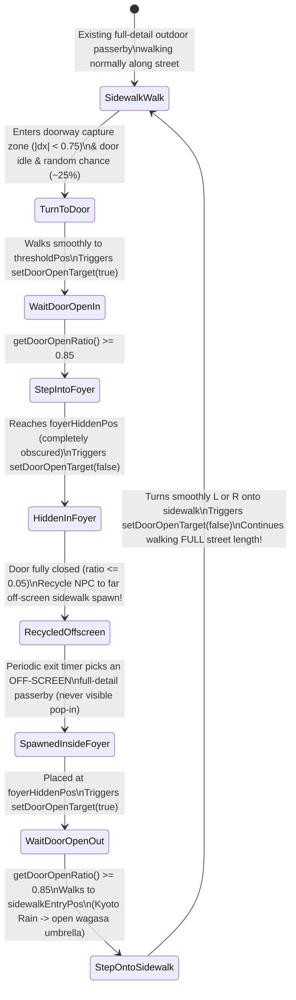

# Klasik 3D — Detail Truncation & Grounding Fix Plan (`detail truncation fix.md`)

> **Target Repo:** `BoostedByCaffeine/Klasik3D`
> **Goal:** Eliminate all downgraded/stub NPC meshes, teleporting doorway walkers, broken Cyberpunk hover-cars/neon highway bleed, Minecraft-blocky Kyoto cyclists, detached Mayon tourist bags, leftover perimeter cone mountains, and floating corner mountains—**without** choking the coding agent on the 583 KB `scene3d.ts` monolith.

---

## 0. Anti-Overkill Strategy (Read Before Touching Any File)

To prevent multi-hour context loops, diff failures, and quota exhaustion:

1. **Run strictly ONE phase per fresh agent session** (Phase A → commit → Phase B → commit → Phase C → commit → Phase D → commit). Never chain all phases into a single run.
2. **Sidecar-First Architecture (Freeze `scene3d.ts` Growth):**
   - Put all new articulated rigs, doorway handoff logic, and Cyberpunk vehicle builders inside **3 small, self-contained sidecar modules** (`<= 300` lines each):
     - `src/game/outdoorNpcRig.ts` *(NEW)* — Unified full-detail articulated outdoor NPC rig, strict bone-parented props, and detailed Kyoto *mamachari* cyclist.
     - `src/game/doorwayTraffic.ts` *(NEW)* — Real sidewalk-passerby-to-doorway handoff state machine (zero teleportation, zero stub clones).
     - `src/game/sceneries/cyberpunkAssets.ts` *(NEW)* — Watertight aerial hover-cars (`skipStaticBatch: true`) and matte highway surface helpers.
   - Touch `src/game/scene3d.ts` **ONLY in Phase B** with surgical hooks (**max ~25 lines added/edited**). Do NOT read the entire file—search only for the outdoor passerby array/update loop and scenery load hook.
3. **Never Run Watch-Mode Tests:** Always use the non-interactive verification gate at the end of every phase:
   ```bash
   npx tsc --noEmit && npx vitest run && npm run build
   ```
4. **Indoor FPS Invariant:** Every outdoor NPC, cyclist, alley walker, animated doorway, and foreground outcrop MUST remain inside `outdoorOnlyGroup` and be completely skipped when `isPlayerOutside === false`. Horizon/perimeter mountains stay inside `windowBackdropGroup` (`alwaysVisibleBackdrop = true`, shared vertex-colored material, `castShadow = false`, `receiveShadow = false`).

### Phase & File Scope Map

| Phase | Fixes Covered | Files Created / Edited | `scene3d.ts` Touched? |
| :---: | :--- | :--- | :---: |
| **Phase A** | #4 Overlook NPCs & detached Mayon bags; #5 Blocky Kyoto cyclist | `src/game/outdoorNpcRig.ts` *(NEW)*, `src/game/sceneries/sceneriesPart1.ts` | **NO** |
| **Phase B** | #1 Teleporting & downgraded doorway NPCs (all sceneries with animated doors) | `src/game/doorwayTraffic.ts` *(NEW)*, `src/game/sceneries/sceneryTypes.ts`, `src/game/sceneries/surroundingContext.ts`, `src/game/sceneries/sceneriesPart1.ts`, `src/game/sceneries/sceneriesPart2.ts`, `src/game/scene3d.ts` *(surgical <= 25 lines)* | **YES (minimal hook)** |
| **Phase C** | #2 Cyberpunk limbless alley walkers, corrupted hover-cars, glowing neon highway | `src/game/sceneries/cyberpunkAssets.ts` *(NEW)*, `src/game/sceneries/sceneriesPart2.ts`, `src/game/sceneries/SceneryManager.ts` *(skipStaticBatch guard)* | **NO** |
| **Phase D** | #3 Perimeter pointy cones around cafe (4 sceneries); #6 Floating L/R corner mountains (Hilltop & Switzerland) | `src/game/sceneries/mountainRanges.ts`, `src/game/sceneries/surroundingContext.ts`, `src/game/sceneries/sceneriesPart1.ts`, `src/game/sceneries/sceneriesPart2.ts` | **NO** |

---

## Phase A — Unified Articulated Outdoor NPC Rig, Bone-Parented Props & Smooth Kyoto Cyclist

**Fixes:** Issue #4 (Truncated overlook NPCs + detached Mayon tourist bags) & Issue #5 (Blocky "Minecraft" Kyoto cyclist).
**File Scope:** `src/game/outdoorNpcRig.ts` *(NEW)*, `src/game/sceneries/sceneriesPart1.ts`

### A.1 Unified Articulated Rig (`src/game/outdoorNpcRig.ts`)
Build a single shared factory `createArticulatedOutdoorNpc(options)` matching the silhouette, smooth proportions, and visual fidelity of the game's primary outdoor pedestrians (never flat cube/cylinder stubs).

#### Mandatory Bone Hierarchy (Fixes Detached Accessories Forever)

```text
npcRoot (THREE.Group — handles world X/Y/Z position & yaw facing)
 └── pelvisPivot (subtle vertical walk bob: Math.abs(Math.sin(phase)) * 0.035)
      ├── torso (tapered rounded torso/jacket + collar/hem)
      │    ├── neck -> headPivot (smooth SphereGeometry head, subtle eyes/brows, sculpted hair cap/bun)
      │    │    └── [SLOT: headwear]  <-- woven salakot, sun hat, kanzashi pins, cyber visor
      │    ├── [SLOT: backProp]       <-- tourist backpack (local: x=0, y=0.06, z=-0.16)
      │    ├── leftShoulderPivot -> upperArm -> elbowPivot -> forearm -> leftHandSlot
      │    │    └── [SLOT: leftHandProp]   <-- rain umbrella / wagasa / pasalubong bag
      │    └── rightShoulderPivot -> upperArm -> elbowPivot -> forearm -> rightHandSlot
      │         └── [SLOT: rightHandProp]  <-- camera / smartphone / tote bag
      ├── leftHipPivot  -> thigh -> leftKneePivot  -> calf -> shoe
      └── rightHipPivot -> thigh -> rightKneePivot -> calf -> shoe
```

- **Strict Bone-Parenting Rule:** Every bag, backpack, camera, umbrella, and hat **MUST** be attached to its corresponding slot inside the rig (`backProp`, `leftHandSlot`, `rightHandSlot`, `headwear`). Never place bags as siblings under the scenery group and never animate a bag with an independent sine wave.
- **Smooth Primitives Only:** Use `CapsuleGeometry` / `CylinderGeometry` (8–10 radial segments) + `SphereGeometry` joints for limbs and head so silhouettes read smoothly from both walk-around and overlook cameras—never raw sharp-edged `BoxGeometry` limbs.
- **Built-In Pose & Walk Driver:** Export `updateArticulatedNpcPose(rig, dt, state)` supporting:
  - `'walk'` (synced opposite arm/leg swing, slight knee bend, pelvis bob)
  - `'idle_browse'` (gentle breathing sway, head look-around)
  - `'photo_pose'` (raises `rightShoulderPivot` & `elbowPivot` to hold camera/phone toward target—camera moves rigidly with hand)
  - `'vendor_tend'` (behind-counter subtle sway + periodic gesturing arm)
  - `'cycling'` (seated torso lean, arms reaching forward to grips, 2-bone hip+knee pedaling driven by crank angle)
- **Outfit Compatibility:** Tag rig parts cleanly so `applyPatronOutfitToRig()` (and Secret NPC immunity) work identically across all outdoor NPCs.

### A.2 Mayon Overlook Tourists & Vendors Upgrade (`sceneriesPart1.ts`)
- Replace all truncated/blocky overlook tourists and market vendors in `mayon_volcano` with `createArticulatedOutdoorNpc()`.
- Delete any standalone bag-bobbing or detached bag position updates. Attach backpacks strictly to `rig.slots.backProp`, pasalubong totes to `rig.slots.leftHandProp`, cameras/phones to `rig.slots.rightHandProp`, and woven *salakot* / sun hats to `rig.slots.headwear`.
- Verify walking and standing tourists move as one cohesive articulated unit with zero lagging or floating bags.

### A.3 Detailed Japanese Tranquility *Mamachari* Cyclist (`outdoorNpcRig.ts` + `sceneriesPart1.ts`)
Replace the blocky "Minecraft" cyclist with `createKyotoCyclist(options)` inside `outdoorNpcRig.ts`:

```text
                (Smooth articulated rider: Capsule limbs, Sphere head, hair, casual jacket/kimono-haori)
                     \   [hands anchored to grips]
             [saddle] \ /--[handlebars + brass bell]
                │     / \   [woven rattan front basket + parcel]
                ├────/   \
           ┌────┴───┐     \
          (  Rear    )═══(o)───(  Front   )
          (  Wheel   )  crank  (  Wheel   )
           └───┬────┘           └────────┘
         [mudguard + rack]    [thin Torus tire + hub + 8 wire spokes]
```

- **Rider:** Built from `createArticulatedOutdoorNpc()` in `'cycling'` pose—rounded shoulders, articulated forearms gripping the swept cruiser handlebars, knees bending realistically as feet orbit the crank radius (`crankAngle += (speed * dt) / wheelRadius`).
- **Bicycle Details:** Tubular steel step-through frame (`CylinderGeometry`), thin `TorusGeometry` rubber tires, rotating 8-spoke inner wheel groups, curved mudguards over both wheels, spring saddle, rear rack, front fork, curved cruiser handlebars with grips + brass bell, and woven rattan front basket.
- **Performance:** Keep cyclist groups inside `outdoorOnlyGroup` and skip updates when `isPlayerOutside === false`.

### Phase A Verification Gate
- [ ] `src/game/outdoorNpcRig.ts` compiles cleanly and exports `createArticulatedOutdoorNpc`, `updateArticulatedNpcPose`, and `createKyotoCyclist`.
- [ ] All Mayon overlook tourists & vendors use the articulated rig; bags/cameras/hats are strictly bone-parented and stay locked to bodies during every animation frame.
- [ ] Kyoto cyclists render with smooth articulated riders and detailed spoked *mamachari* bicycles (zero blocky cube limbs).
- [ ] `npx tsc --noEmit && npx vitest run && npm run build` exits `0`.

---

## Phase B — Seamless Sidewalk-to-Doorway Passerby Handoff (Zero Teleportation)

**Fixes:** Issue #1 (Doorway NPCs teleporting out of nowhere, disappearing after a few steps, and using downgraded stub assets across `busy_street`, `cyberpunk_neon`, and `japanese_tranquility`).
**File Scope:** `src/game/doorwayTraffic.ts` *(NEW)*, `src/game/sceneries/sceneryTypes.ts`, `src/game/sceneries/surroundingContext.ts`, `src/game/sceneries/sceneriesPart1.ts`, `src/game/sceneries/sceneriesPart2.ts`, `src/game/scene3d.ts` *(<= 25 lines surgical hook)*

### Root Cause of Teleportation
The previous implementation spawned isolated low-detail mini-NPCs right outside a door, walked them 2 meters, and despawned them in mid-air. **Delete all stub doorway NPC spawners completely.**

### Seamless Handoff Architecture (`src/game/doorwayTraffic.ts`)
Each scenery with animated doors (`busy_street`, `cyberpunk_neon`, `japanese_tranquility`) registers **doorway anchors only** (no private NPCs!) on the scenery instance:

```ts
export interface AnimatedDoorwayAnchor {
  id: string;
  sidewalkEntryPos: THREE.Vector3; // Exact point on main sidewalk aligned with door center
  thresholdPos: THREE.Vector3;     // Door frame center
  foyerHiddenPos: THREE.Vector3;   // Deep inside recessed foyer/genkan (depth >= 1.6u behind door)
  facingOutYaw: number;            // Yaw pointing out onto the street
  setDoorOpenTarget: (open: boolean) => void;
  getDoorOpenRatio: () => number;  // 0.0 (closed) -> 1.0 (fully open)
  isJapaneseMachiya?: boolean;     // Triggers rain wagasa umbrella on exit
}
```

#### Unified Passerby-to-Doorway State Machine



### Key Non-Negotiable Rules
1. **Zero Mid-Street Pop-In / Pop-Out:**
   - **Entering NPCs** are real, full-detail outdoor pedestrians already walking down the sidewalk from far off-screen. They never vanish outside the door—they walk fully into the dark recessed foyer (`depth >= 1.6u`), wait until the door closes (`ratio <= 0.05`), and only then relocate to the far off-screen sidewalk edge (`|x| >= sidewalkMaxX`).
   - **Exiting NPCs** are pulled from the off-screen recycled passerby pool (already using full outdoor pedestrian meshes + `resolveActivePatronOutfit()` + Secret NPC immunity), positioned hidden inside `foyerHiddenPos` *before* the door opens, walk out onto the sidewalk, turn left or right, and merge seamlessly into normal `'SidewalkWalk'` so they continue walking all the way down the block and around the T-junction.
2. **Surgical `scene3d.ts` Integration (`<= 25` lines):**
   - Import `DoorwayTrafficController` from `./doorwayTraffic`.
   - Pass the active scenery's `doorways` array and the existing outdoor pedestrian pool into `doorwayTraffic.update(dt, outdoorPedestrians, isRaining)` strictly inside `if (isPlayerOutside) { ... }`.
   - When a pedestrian is currently claimed by `doorwayTraffic` (`ped.doorwayState !== 'none'`), skip its default straight-line X-advance for that frame so `doorwayTraffic` smoothly drives its position and facing without fighting `scene3d.ts`.

### Phase B Verification Gate
- [ ] All legacy stub doorway mini-NPCs removed from `surroundingContext.ts`, `sceneriesPart1.ts`, and `sceneriesPart2.ts`.
- [ ] `busy_street`, `cyberpunk_neon`, and `japanese_tranquility` register `AnimatedDoorwayAnchor[]` on `SceneryInstance`.
- [ ] Real full-detail outdoor pedestrians smoothly turn off the sidewalk into doors, disappear only after the door shuts behind them, and exiting pedestrians emerge from inside closed doorways and continue walking the full street length.
- [ ] `scene3d.ts` diff stays surgical (`<= 30` lines changed) and indoor FPS stays untouched.
- [ ] `npx tsc --noEmit && npx vitest run && npm run build` exits `0`.

---

## Phase C — Cyberpunk Neon Rescue (Alley Walkers, Hover-Cars & Clean Highway)

**Fixes:** Issue #2 (Limbless/truncated Cyberpunk alley walkers, corrupted/incomplete floating cars, glowing neon bleeding onto the highway).
**File Scope:** `src/game/sceneries/cyberpunkAssets.ts` *(NEW)*, `src/game/sceneries/sceneriesPart2.ts`, `src/game/sceneries/SceneryManager.ts`

### C.1 Static Batching Protection (`SceneryManager.ts`)
> **Why hover-cars looked incomplete/corrupted:** `batchStaticMeshesByMaterial(instance.root)` can accidentally strip or merge sub-meshes of animated vehicle groups if they aren't explicitly guarded!

- In `batchStaticMeshesByMaterial()` (`SceneryManager.ts` / `sceneryTypes.ts`), immediately skip traversing any `Object3D` where `obj.userData.skipStaticBatch === true` OR any descendant of an animated entity/vehicle/NPC/doorway group.

### C.2 Watertight Aerial Hover-Car Builder (`src/game/sceneries/cyberpunkAssets.ts`)
Replace the broken/incomplete floating car generator with `createCyberHoverCar(variant)` tagged `group.userData.skipStaticBatch = true`:

```text
           [Sloped Tinted Cockpit Canopy]
         ___/══════════════════════════\___
   ┌────/   [Twin Side Intake Pods]        \────┐  <-- Rear Spoiler Fin
   │  (■)  Matte-Obsidian Wedge Fuselage   [══] │  <-- Full-Width Glowing Tailbar
   └───┬────────────────────────────────────┬───┘
      [O] (Recessed Under-Thruster Rings)  [O]     <-- Tight local glow only (radius <= 0.35)
```

- **Complete Hull Parts (Zero Missing Faces, `THREE.FrontSide`):**
  1. Main sculpted lower wedge chassis (dark metallic gunmetal/obsidian `#161A24`, `metalness: 0.65`, `roughness: 0.32`).
  2. Flush upper cockpit canopy (dark reflective glass `#0B1320`, seated cleanly onto chassis with zero gaps).
  3. Left and right side pontoon/intake pods flush along the flanks.
  4. Crisp white front dual headlight strips (`emissive: 0xE6F7FF`) and full-width rear taillight bar (`emissive: 0xFF2255` or `#00F0FF`).
  5. 4 compact recessed underside thruster rings (`y = -0.18` local, NO giant downward light cones or wide ground-clipping planes).
- Keep all aerial hover-car cruise lanes strictly elevated (`y >= 5.8`) so their glow never touches or clips the highway.

### C.3 Clean Dark Matte Highway Surface (`sceneriesPart2.ts`)
- Audit all road/highway meshes and decals in `cyberpunk_neon`:
  - **Delete** any wide neon-colored highway plane, emissive road strips, neon under-road glow quads, or additive ground decals bleeding bright cyan/magenta across the asphalt.
  - Set highway asphalt to realistic **dark rain-damp charcoal** (`color: 0x151821`, `emissive: 0x000000`, `roughness: 0.70`, `metalness: 0.08`) with crisp, restrained road markings (muted white dashed lanes `#6B7280`, subtle double amber center lines `#B45309`, `y = 0.014` above road surface to prevent z-fighting).
  - Keep neon color strictly on elevated storefronts, holographic signs, distant skyscrapers, and thin vertical curb accents—never flooding the driving lane asphalt.

### C.4 Articulated Cyberpunk Alley Walkers (`sceneriesPart2.ts`)
- Replace every limbless/truncated alley walker with `createArticulatedOutdoorNpc()` from `src/game/outdoorNpcRig.ts` (full head, hair/cyber-visor, articulated swinging arms and legs, dark techwear jacket palette).
- **Clean Spawn/Despawn Bounds:** Start and end each alley walker path **deep inside the shadowed alley canyon** (hidden behind building corners, outside the street sightline), walk smoothly out to the main sidewalk, turn cleanly along the sidewalk segment (or cross into an adjacent alley), and never pop into view in the open. Parent strictly inside `outdoorOnlyGroup`.

### Phase C Verification Gate
- [ ] `batchStaticMeshesByMaterial()` respects `userData.skipStaticBatch === true` and never strips animated vehicle sub-meshes.
- [ ] Cyberpunk hover-cars render complete, watertight, and cleanly animated well above street level (`y >= 5.8`).
- [ ] Cyberpunk highway asphalt is clean dark charcoal with restrained lane markings—zero glowing neon wash on the road.
- [ ] Cyberpunk alley walkers have full articulated arms, legs, heads, and smooth walk cycles with zero pop-in.
- [ ] `npx tsc --noEmit && npx vitest run && npm run build` exits `0`.

---

## Phase D — 360° Surrounding Cone Mountain Eradication & Corner Grounding

**Fixes:** Issue #3 (Pointy cone mountains still beside the overlook / surrounding the cafe in `mayon_volcano`, `hilltop_city_lights`, `switzerland_hilltop`, `mt_everest`) & Issue #6 (Floating mountains toward both left and right overlook corners in `hilltop_city_lights` and `switzerland_hilltop`).
**File Scope:** `src/game/sceneries/mountainRanges.ts`, `src/game/sceneries/surroundingContext.ts`, `src/game/sceneries/sceneriesPart1.ts`, `src/game/sceneries/sceneriesPart2.ts`

### D.1 Fix 4-Edge Perimeter Grounding in `mountainRanges.ts`
> **Why left & right overlook corners were floating:** Curved horizon ribbons often drop only the front/back edge—leaving the **left (`u = 0`) and right (`u = 1`) end-caps** hovering in mid-air above the valley floor or coastal sea!

```text
   TOP-DOWN VIEW OF CURVED MOUNTAIN RIBBON (4-EDGE SKIRT LOCK)

        u=0 (Left Corner End-Cap)                  u=1 (Right Corner End-Cap)
        ████████████████████████████████████████████████████████████  <-- Back Edge (drop to skirtFloorY)
        █  DROP TO skirtFloorY    [Ridged Peaks & Saddles]   DROP  █
        █  (<= -36)                                        TO -36  █
        ████████████████████████████████████████████████████████████  <-- Front Edge (drop to skirtFloorY)
```

- Update `createMountainRangeRibbon()` in `src/game/sceneries/mountainRanges.ts` so **every single perimeter vertex** (`ix === 0 || ix === widthSegs || iz === 0 || iz === depthSegs`) is forced straight down to `options.skirtFloorY` (`-34` for Hilltop, `-38` for Switzerland, `-28` for Everest, `-16` for Mayon foothills).
- Update `createRidgedPeakGeometry()` so its entire outermost base ring drops vertically to `options.skirtFloorY` with zero floating lip.

### D.2 Deterministic Repo-Wide Cone Audit (Zero Missed Side Mountains)
Run this exact search before editing:
```bash
grep -rn "ConeGeometry" src/game/sceneries/
```
Apply this strict decision table to **every single match** across `surroundingContext.ts`, `sceneriesPart1.ts`, and `sceneriesPart2.ts`:

| Match Category | Action |
| :--- | :--- |
| **Mayon Volcano Hero Cone** (the single iconic symmetrical stratovolcano landmark) | **KEEP UNTOUCHED** |
| Pine/spruce tree layers, lamp shades, traffic cones, *salakot* hats (`radius < 5`) | **KEEP UNTOUCHED** |
| **ANY mountain/hill/peak `ConeGeometry` (`radius >= 5` or `height >= 7`)** in `surroundingContext.ts`, `sceneriesPart1.ts`, or `sceneriesPart2.ts` for `mayon_volcano`, `hilltop_city_lights`, `switzerland_hilltop`, or `mt_everest` | **REPLACE** with `createRidgedPeakGeometry()` or `createMountainRangeRibbon()` from `mountainRanges.ts` using that scenery's matching biome preset (`MAYON_FOOTHILLS`, `COASTAL_SIERRA`, `SWISS_ALPINE`, `HIMALAYAN_HORN`) |

### D.3 Fix Left & Right Overlook Corner Floating Gaps (`hilltop_city_lights` & `switzerland_hilltop`)
1. **Audit Both Overlook Corner Quadrants** (`x < -12` Left Corner and `x > 12` Right Corner, facing toward the overlook vista) in `surroundingContext.ts`, `sceneriesPart1.ts` (Hilltop), and `sceneriesPart2.ts` (Switzerland):
   - Replace every corner mountain mesh with grounded ridged massifs/ribbons using `skirtFloorY = -36` (Hilltop) and `skirtFloorY = -40` (Switzerland).
   - Extend the angular span (`startAngle` / `endAngle`) of the main vista mountain ribbon by `±0.25 rad` (or seat overlapping flanking ridged peaks at both corners) so the side hills stitch seamlessly into the main overlook mountain range with **zero daylight or void slits** at either corner.
2. **Extend Base Sea / Valley Planes Past Both Corners:**
   - **Hilltop City Lights:** Ensure the shimmering coastal bay/ocean plane spans at least `320 x 320` units centered beneath the vista so water continues smoothly underneath both left and right corner ridges into horizon fog.
   - **Switzerland Hilltop:** Ensure the alpine valley/lake floor plane spans at least `320 x 320` units underneath both left and right corner massifs, while keeping viaduct bridge embankments and both funicular timber lodges seated flush and unobstructed.
3. **Batching & Culling Safety:** Place all newly replaced perimeter/vista mountain meshes on the scenery's shared `createSharedMountainMaterial()`, `castShadow = false`, `receiveShadow = false`, inside `windowBackdropGroup` (`alwaysVisibleBackdrop = true`).

### Phase D Verification Gate
- [ ] `grep -rn "ConeGeometry" src/game/sceneries/` confirms **zero** non-tree mountain cones remain anywhere in `surroundingContext.ts`, `sceneriesPart1.ts`, or `sceneriesPart2.ts` (except Mayon Volcano's hero peak).
- [ ] `mountainRanges.ts` forces all 4 ribbon perimeter edges (`ix=0`, `ix=widthSegs`, `iz=0`, `iz=depthSegs`) and peak outer rings down to `skirtFloorY`.
- [ ] Looking left, center, and right from the overlook on both `hilltop_city_lights` and `switzerland_hilltop` shows zero floating mountain edges and zero void gaps underneath corners.
- [ ] `npx tsc --noEmit && npx vitest run && npm run build` exits `0`.

---

## Single-Phase Agent Prompt Template (Copy & Paste One Phase at a Time)

> Replace `[PHASE LETTER]` with `A`, `B`, `C`, or `D` in a **fresh chat session** after committing the previous phase.

```markdown
Execute ONLY **Phase [PHASE LETTER]** from `detail truncation fix.md` in `BoostedByCaffeine/Klasik3D`.

Strict rules:
1. Read ONLY `detail truncation fix.md` and the files listed in **Phase [PHASE LETTER]'s File Scope** (do NOT read full unrelated files or rewrite `scene3d.ts`).
2. Follow every architectural constraint, bone-parenting rule, and anti-overkill guardrail in Section 0 and Phase [PHASE LETTER].
3. When finished, run the non-watch verification gate:
   `npx tsc --noEmit && npx vitest run && npm run build`
4. Fix any errors until all three commands exit `0`, then STOP and output a brief summary of files changed and checks verified. Do NOT start the next phase.
```