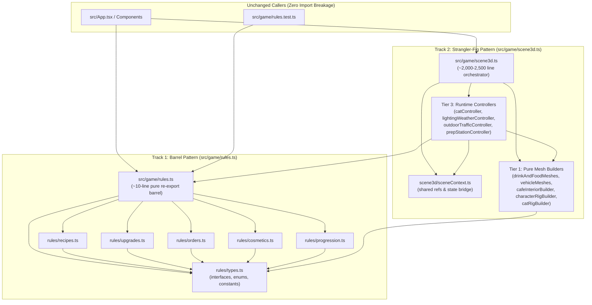

# Klasik 3D — Monolith Refactoring Blueprint (`refactor monoliths.md`)

> **Target Repo:** `BoostedByCaffeine/Klasik3D`
> **Targets:** `src/game/rules.ts` (~4,000+ lines) and `src/game/scene3d.ts` (~15,200+ lines)
> **Objective:** Safely break both monoliths into focused, low-token modules (`<= 900` lines each) with **zero runtime behavior changes** and **zero broken imports**, preparing the codebase for fast execution of `detail truncation fix.md`.

---

## 0. Anti-Token-Burn & Safety Rules (Mandatory for Coding Agent)

1. **Pure Code Movement Only (Zero Behavior Changes):**
   - Do **NOT** fix bugs, change 3D coordinates, tweak materials, or implement anything from `detail truncation fix.md` during this refactor.
   - If a function has a quirk, move it **verbatim**. Behavior changes belong in separate commits later.
2. **Never Read `scene3d.ts` or `rules.ts` Whole Into Context:**
   - Do **NOT** dump 15,200 lines into context. Always run the lightweight **Node Symbol Indexer** (Section 4.1) first to locate exact start/end line numbers, inspect only the boundary lines (`±15` lines), and slice blocks verbatim via Node.js.
3. **Verbatim Slicing Over Manual Rewriting:**
   - Never ask the LLM to re-type 1,500 lines of Three.js code from memory—that wastes output tokens and introduces brace/sign typos. Use the **Node Line-Slicer** (Section 4.2) to move exact line ranges on disk, then add clean `import` / `export` headers.
4. **One Phase Per Fresh Chat Session + Immediate Commit:**
   - Execute strictly **one phase** (`R1`, `R2`, `S1`, `S2`, `S3`, `S4`, or `S5`), pass the non-watch verification gate, and `git commit` before opening a fresh session for the next phase.
5. **Non-Watch Verification Gate (Run After EVERY Phase):**
   ```bash
   npx tsc --noEmit && npx vitest run && npm run build
   ```
   *(Never run `npm test` without confirming it is non-watch; always prefer `npx vitest run`.)*

---

## 1. Target Dependency Architecture (Zero Circular Imports)

All extracted modules MUST follow a strict **Directed Acyclic Graph (DAG)**. Lower layers may never import from higher orchestrators.



---

## 2. Track 1 — Barrel-Split `src/game/rules.ts` (Phases R1–R2)

Because `src/game/rules.test.ts` already tests `rules.ts` extensively, splitting `rules.ts` behind a barrel file gives instant confidence and zero import churn across `src/App.tsx`, `src/components/*`, and `src/game/scene3d.ts`.

### Phase R1 — Extract Types, Recipes & Upgrades
**Target Folder:** `src/game/rules/` *(NEW)*
**File Scope:** `src/game/rules.ts`, `src/game/rules/types.ts`, `src/game/rules/recipes.ts`, `src/game/rules/upgrades.ts`

1. Run the **Node Symbol Indexer** (Section 4.1) on `src/game/rules.ts` to map exact line ranges of every `export interface`, `export type`, `export const`, and `export function`.
2. Slice verbatim into:
   - `src/game/rules/types.ts` — All shared TypeScript interfaces, union types, scenery IDs, order/customer state shapes, and core constants (zero imports from sibling rule files).
   - `src/game/rules/recipes.ts` — Drink & pastry catalogs, ingredient pricing, cold-climate temperature bias helpers (`getSceneryDrinkTempBias`).
   - `src/game/rules/upgrades.ts` — Business upgrades, cookie jar / scenery unlock tables, shop economy calculations.
3. Add `export * from './rules/types';`, `export * from './rules/recipes';`, and `export * from './rules/upgrades';` at the top of `src/game/rules.ts` and import needed symbols internally inside the remaining half of `rules.ts`.
4. **Phase R1 Gate:**
   - [ ] `src/game/rules/types.ts`, `recipes.ts`, and `upgrades.ts` created via verbatim slicing.
   - [ ] Zero edits required in `src/App.tsx`, `src/components/*`, or `src/game/rules.test.ts`.
   - [ ] `npx tsc --noEmit && npx vitest run && npm run build` exits `0`.

### Phase R2 — Extract Orders, Cosmetics & Progression (Finalize Barrel)
**File Scope:** `src/game/rules.ts`, `src/game/rules/orders.ts`, `src/game/rules/cosmetics.ts`, `src/game/rules/progression.ts`

1. Slice the remaining blocks of `src/game/rules.ts` verbatim into:
   - `src/game/rules/orders.ts` — Customer order generation, mood/patience scoring, pre-acceptance order prep guards (`canStartOrderPrep`, `canServePreparedItem`).
   - `src/game/rules/cosmetics.ts` — Patron outfit resolution (`resolveActivePatronOutfit`), manual/custom-mix/auto-match logic, Secret NPC immunity checks, cat cosmetic unlock rules.
   - `src/game/rules/progression.ts` — Day cycle transitions, daily goals, order quotas, localStorage save/load and migration helpers.
2. Replace `src/game/rules.ts` with a pure barrel file (~10 lines):
   ```ts
   export * from './rules/types';
   export * from './rules/recipes';
   export * from './rules/upgrades';
   export * from './rules/orders';
   export * from './rules/cosmetics';
   export * from './rules/progression';
   ```
3. **Phase R2 Gate:**
   - [ ] `src/game/rules.ts` is `<= 20` lines of pure re-exports.
   - [ ] Every existing test in `src/game/rules.test.ts` passes without modification.
   - [ ] `npx tsc --noEmit && npx vitest run && npm run build` exits `0`.

---

## 3. Track 2 — Strangler-Fig Split of `src/game/scene3d.ts` (Phases S1–S5)

Follow the exact standalone pattern already working in `patronOutfits3d.ts`, `catCosmetics3d.ts`, `secretNpc3d.ts`, `OutdoorOverlookController.ts`, and `CounterAudioProps.ts`. Always extract **pure stateless mesh builders first** (Tier 1), then introduce a lightweight **shared context** (Tier 2), then move **stateful update controllers** (Tier 3).

### Phase S1 — Tier 1A: Pure Drink, Food & Vehicle Mesh Builders
**Target Folder:** `src/game/scene3d/` *(NEW)*
**File Scope:** `src/game/scene3d.ts`, `src/game/scene3d/drinkAndFoodMeshes.ts` *(NEW)*, `src/game/scene3d/vehicleMeshes.ts` *(NEW)*
**Estimated Cut:** ~2,500–3,500 lines removed from `scene3d.ts`

1. Run the **Node Symbol Indexer** on `src/game/scene3d.ts` to find exact line ranges for drink/cup/pastry mesh builders and vehicle mesh builders.
2. Slice pure mesh-construction helpers verbatim into:
   - `src/game/scene3d/drinkAndFoodMeshes.ts` — Hot/iced cups, glasses, liquid/milk/ice/foam meshes, syrups, espresso portafilter/machine props, pastries, plates, and takeaway boxes.
   - `src/game/scene3d/vehicleMeshes.ts` — Parked 1990 Mazda Miata MX-5 builder, standard delivery scooter, Japanese delivery bicycle, Cyberpunk floating hover-scooter, and `syncDeliveryRiderVehicle` geometry helper.
3. Replace moved definitions in `scene3d.ts` with clean imports and verify any helper that previously closed over a shared material/texture receives it via a small typed parameter object.
4. **Phase S1 Gate:**
   - [ ] Zero runtime/visual changes; pure extraction only.
   - [ ] `npx tsc --noEmit && npx vitest run && npm run build` exits `0`.

### Phase S2 — Tier 1B: Cafe Interior, Character & Cat Rig Builders
**File Scope:** `src/game/scene3d.ts`, `src/game/scene3d/cafeInteriorBuilder.ts` *(NEW)*, `src/game/scene3d/characterRigBuilder.ts` *(NEW)*, `src/game/scene3d/catRigBuilder.ts` *(NEW)*
**Estimated Cut:** ~3,000–4,000 lines removed from `scene3d.ts`

1. Re-run the **Node Symbol Indexer** on the now-smaller `src/game/scene3d.ts` for exact line ranges.
2. Slice pure scene/rig assembly functions verbatim into:
   - `src/game/scene3d/cafeInteriorBuilder.ts` — Cafe shell walls, floor, counter geometry, shelves, menu boards, garage-garden props, title-screen signage, and indoor light fixtures.
   - `src/game/scene3d/characterRigBuilder.ts` — Base customer and outdoor pedestrian rig assembly functions, facial/hair builders, and shared pedestrian material caches.
   - `src/game/scene3d/catRigBuilder.ts` — All 12 cat procedural rig builders (Champy, Lilo, Amby, Gigi, Tisay, etc.), closed-eyelid arc meshes (`closedEyeL`, `closedEyeR`), and `setCatEyesClosed()`.
3. Return typed handle objects from each builder (e.g., `{ root, interactiveMeshes, doorPivot, ... }`) so `scene3d.ts` binds references cleanly without relying on giant module-level `let` variables.
4. **Phase S2 Gate:**
   - [ ] `scene3d.ts` is now under ~9,000 lines.
   - [ ] All 12 cats, customer rigs, and cafe interior props build identically.
   - [ ] `npx tsc --noEmit && npx vitest run && npm run build` exits `0`.

### Phase S3 — Tier 2: Shared `SceneRuntimeContext` Bridge
**File Scope:** `src/game/scene3d.ts`, `src/game/scene3d/sceneContext.ts` *(NEW)*

Before moving stateful `update(dt)` loops out of `scene3d.ts`, define a clean, explicit state bridge so extracted controllers never need circular imports or 25-argument functions:

```ts
// src/game/scene3d/sceneContext.ts
import type * as THREE from 'three';

export interface SceneRuntimeContext {
  scene: THREE.Scene;
  camera: THREE.PerspectiveCamera;
  renderer: THREE.WebGLRenderer;
  isPlayerOutside: boolean;
  isCapacitorApk: boolean;
  graphicsQuality: 'low' | 'medium' | 'high';
  activeSceneryId: string;
  weather: string;
  timeOfDay: string;
  // Add references to existing scene groups, active scenery instance,
  // and shared pools (cats, customers, outdoorPedestrians) already owned by scene3d.ts
}
```

1. Create `src/game/scene3d/sceneContext.ts` containing `SceneRuntimeContext` and shared helper types currently scattered inside `scene3d.ts`.
2. Instantiate and keep `ctx` synchronized inside `scene3d.ts` (zero behavior change).
3. **Phase S3 Gate:**
   - [ ] `sceneContext.ts` compiles cleanly with zero circular imports.
   - [ ] `npx tsc --noEmit && npx vitest run && npm run build` exits `0`.

### Phase S4 — Tier 3A: Cat Controller & Lighting/Weather Controller
**File Scope:** `src/game/scene3d.ts`, `src/game/scene3d/sceneContext.ts`, `src/game/scene3d/catController.ts` *(NEW)*, `src/game/scene3d/lightingWeatherController.ts` *(NEW)*
**Estimated Cut:** ~2,500–3,500 lines removed from `scene3d.ts`

1. Extract `src/game/scene3d/catController.ts`:
   - Owns cat state machines (idle, wandering, sleeping/blinking, grooming, petting/feeding/combing reactions) and exposes `updateCats(ctx, dt)` + interaction handlers.
2. Extract `src/game/scene3d/lightingWeatherController.ts`:
   - Owns day/sunset/night sky & light palettes, fog transitions, rain/snow particle systems, and WebGL graphics-tier / Android APK `low-fx` pixel-ratio & shadow toggles.
   - Exposes `applyLightingAndWeather(ctx)` and `updateWeatherParticles(ctx, dt)`.
3. Call both controllers cleanly from `scene3d.ts`'s main animation loop.
4. **Phase S4 Gate:**
   - [ ] `scene3d.ts` is now under ~6,000 lines.
   - [ ] `npx tsc --noEmit && npx vitest run && npm run build` exits `0`.

### Phase S5 — Tier 3B: Outdoor Traffic & Prep Station Controllers
**File Scope:** `src/game/scene3d.ts`, `src/game/scene3d/sceneContext.ts`, `src/game/scene3d/outdoorTrafficController.ts` *(NEW)*, `src/game/scene3d/prepStationController.ts` *(NEW)*
**Estimated Cut:** ~3,000–3,500 lines removed from `scene3d.ts`

1. Extract `src/game/scene3d/outdoorTrafficController.ts`:
   - Owns the outdoor pedestrian passerby pool, sidewalk walking loops, T-junction turning paths, Secret NPC outdoor spawns, and delivery rider pathing/update loop.
   - Strictly gates all outdoor traffic updates behind `if (!ctx.isPlayerOutside) return;` to preserve indoor FPS.
   - *(Handoff Benefit: Phase B of `detail truncation fix.md` will hook `doorwayTraffic.ts` directly into this ~600-line file instead of touching a 15,200-line monolith!)*
2. Extract `src/game/scene3d/prepStationController.ts`:
   - Owns counter raycasting, cup/pastry placement slots, pouring/steaming animations, order serving validation hooks, and counter prop state.
3. Verify `src/game/scene3d.ts` is now a clean **~2,000–2,500 line orchestrator** responsible for WebGL lifecycle, camera controls, scenery manager binding, and calling controller `update()` methods.
4. **Phase S5 Gate:**
   - [ ] `src/game/scene3d.ts` reduced from ~15,200 lines to `<= 3,000` lines.
   - [ ] All extracted controllers live cleanly under `src/game/scene3d/`.
   - [ ] `npx tsc --noEmit && npx vitest run && npm run build` exits `0`.

---

## 4. Cross-Platform Node.js Zero-Token Extraction Toolkit

Use these inline Node commands (works identically on Windows PowerShell, Git Bash, macOS, and Linux) so the coding agent never wastes context dumping huge files or rewriting code by hand.

### 4.1 Symbol & Section Line-Number Indexer (Read-Only)
Prints every top-level `function`, `class`, `interface`, `type`, `const`, and major comment banner with exact line numbers:

```bash
node -e "const fs=require('fs');const lines=fs.readFileSync(process.argv[1],'utf8').split(/\r?\n/);lines.forEach((l,i)=>{if(/^(export\s+)?(async\s+)?(function|class|interface|type|const|let)\s+\w+|^\/\/\s*={3,}|^\/\/\s*-{3,}/.test(l))console.log((i+1)+': '+l.slice(0,110));});" src/game/scene3d.ts
```

### 4.2 Verbatim Line-Range Slicer (Zero-Hallucination Move)
Copies lines `START..END` (1-indexed, inclusive) from `SOURCE` into `TARGET` verbatim without LLM re-typing:

```bash
node -e "const fs=require('fs');const[src,dst,s,e]=process.argv.slice(1);const lines=fs.readFileSync(src,'utf8').split(/\r?\n/);const chunk=lines.slice(Number(s)-1,Number(e)).join('\n');fs.mkdirSync(require('path').dirname(dst),{recursive:true});fs.writeFileSync(dst,chunk+'\n','utf8');console.log('Wrote '+(Number(e)-Number(s)+1)+' lines to '+dst);" src/game/scene3d.ts src/game/scene3d/vehicleMeshes.ts 100 450
```

### 4.3 Verbatim Line-Range Remover (Clean Cut After Verifying Slice)
Removes lines `START..END` (1-indexed, inclusive) from `SOURCE` once extracted and imported:

```bash
node -e "const fs=require('fs');const[src,s,e]=process.argv.slice(1);const lines=fs.readFileSync(src,'utf8').split(/\r?\n/);lines.splice(Number(s)-1,Number(e)-Number(s)+1);fs.writeFileSync(src,lines.join('\n'),'utf8');console.log('Removed lines '+s+'..'+e+' from '+src);" src/game/scene3d.ts 100 450
```

*(Tip: Always slice to the new file FIRST, add imports/exports, remove the old lines, and immediately run `npx tsc --noEmit` to catch any missing imports or closed-over variables.)*

---

## 5. Optional Track 3 — Scenery Split (Defer Until After Polish Fixes)

`sceneriesPart1.ts` (~163 KB), `sceneriesPart2.ts` (~126 KB), and `surroundingContext.ts` (~125 KB) are manageable right now—do **not** delay `detail truncation fix.md` to split them. After `detail truncation fix.md` is shipped, you can optionally split them behind barrel files into:
- `src/game/sceneries/scenes/mayonVolcano.ts`
- `src/game/sceneries/scenes/hilltopCityLights.ts`
- `src/game/sceneries/scenes/japaneseTranquility.ts`
- `src/game/sceneries/scenes/brazilianFavela.ts`
- `src/game/sceneries/scenes/cyberpunkNeon.ts`
- `src/game/sceneries/scenes/eiffelTower.ts`
- `src/game/sceneries/scenes/switzerlandHilltop.ts`
- `src/game/sceneries/scenes/mtEverest.ts`
- `src/game/sceneries/scenes/busyStreet.ts`

---

## 6. Post-Refactor Handoff to `detail truncation fix.md`

Once Track 1 (`R1`–`R2`) and Track 2 (`S1`–`S5`) are complete:
- `src/game/rules.ts` is a ~10-line barrel (`rules/*` modules are ~400–800 lines each).
- `src/game/scene3d.ts` is a ~2,000–2,500 line orchestrator (`scene3d/*` modules are ~500–900 lines each).
- **Updated Hook for `detail truncation fix.md` Phase B:** Hook `src/game/doorwayTraffic.ts` directly into `src/game/scene3d/outdoorTrafficController.ts` instead of `src/game/scene3d.ts`—keeping every single polish phase fast, clean, and well within token budgets.

---

## 7. Single-Phase Agent Prompt Template (Copy & Paste One Phase Per Session)

> Replace `[PHASE ID]` with `R1`, `R2`, `S1`, `S2`, `S3`, `S4`, or `S5` in a **fresh chat session** after committing the previous phase.

```markdown
Execute ONLY **Phase [PHASE ID]** from `refactor monoliths.md` in `BoostedByCaffeine/Klasik3D`.

Strict rules:
1. ZERO behavior changes — pure code extraction and import wiring only. Do NOT fix bugs, alter visuals, or edit unrelated files.
2. NEVER dump the entire `scene3d.ts` or `rules.ts` file into context. Use the Node.js Symbol Indexer and Verbatim Line-Range Slicer from Section 4 of `refactor monoliths.md` to inspect exact line numbers and move code verbatim on disk.
3. Preserve all external exports and imports so callers outside Phase [PHASE ID]'s File Scope require zero changes.
4. Run the non-watch verification gate before finishing:
   `npx tsc --noEmit && npx vitest run && npm run build`
5. Fix any TypeScript or Vite bundling errors until all three commands exit `0`, then STOP and report:
   - New files created and their line counts
   - New line count of `src/game/rules.ts` or `src/game/scene3d.ts`
   - Confirmation that `tsc`, `vitest run`, and `build` all exited `0`
Do NOT proceed to the next phase.
```