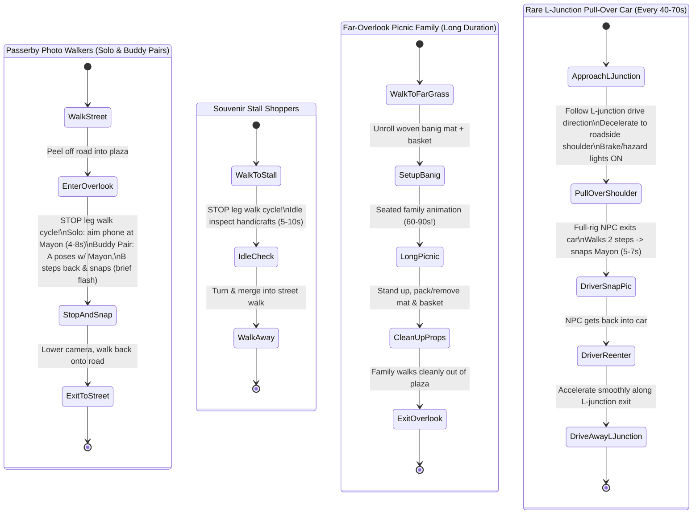

# Klasik 3D — Autonomous Scenery Realism & Asset Polish Plan (`scenery-realism-polish.md`)

> **Target Repo Snapshot:** `BoostedByCaffeine/Klasik3D` (commit `fead4747cc2991da1ea262a1747318bd8de1037c`)
> **Existing Modules Reused Directly:**
> - `src/game/outdoorNpcRig.ts` — Full articulated outdoor NPC rig (MUST be used for ALL new/upgraded overlook NPCs, park walkers, stall shoppers, ramen browsers, and Everest campers)
> - `src/game/doorwayTraffic.ts` — Animated building entry/exit traffic router
> - `src/game/sceneries/cyberpunkAssets.ts` — Cyberpunk alley/vendor/hover-car builders
> - `src/game/sceneries/mountainRanges.ts` — Procedural ridged mountain & horizon ribbon builder
> - `src/game/sceneries/sceneriesPart1.ts`, `src/game/sceneries/sceneriesPart2.ts`, `src/game/sceneries/surroundingContext.ts`, `src/game/sceneries/SceneryManager.ts`, `src/game/sceneries/sceneryTypes.ts`
> - `src/game/outdoorLod.ts`, `src/game/sidewalkAvoidance.ts`, `src/game/patronOutfits3d.ts`
> **New Sidecar Modules to Create:**
> - `src/game/sceneries/mountainTextures.ts` *(Phase 1)*
> - `src/game/sceneries/eiffelParkLife.ts` *(Phase 4)*
> - `src/game/sceneries/mayonOverlookLife.ts` *(Phase 7)*

---

## 0. Autonomous Execution Guardrails (Strict Repo Invariants)

1. **DO NOT Edit Monoliths:** `src/game/scene3d.ts` (~584 KB) and `src/game/rules.ts` (~164 KB) are **READ-ONLY / OFF-LIMITS** for this entire plan. Keep all edits strictly inside `src/game/sceneries/`, `src/game/outdoorNpcRig.ts`, and `src/game/doorwayTraffic.ts`.
2. **Zero Asset Truncation:** Never generate stub boxes, limbless cylinders, or simplified "Roblox" campers. Every overlook tourist, stall shopper, picnic family member, car sightseer, park visitor, ramen browser, and Everest expedition camper **MUST** be constructed through `src/game/outdoorNpcRig.ts` (extending it with expedition/picnic prop helpers if needed) with all accessories (bags, backpacks, cameras, trekking poles) strictly parented to limb/torso bones.
3. **Static-Batching Safety:** Any animated/moving mesh (train, car, NPC, picnic blanket/basket, steam) MUST carry `userData.skipStaticBatch = true` (or match the existing flag checked by `SceneryManager.ts` / `batchStaticMeshesByMaterial`) so static batching never freezes or corrupts moving parts.
4. **Indoor FPS Protection:**
   - All animated overlook crowds, picnic families, park walkers, stall browsers, and pull-over sightseeing cars **MUST** live inside `outdoorOnlyGroup` and be completely skipped inside `update(dt)` when `isPlayerOutside === false`.
   - Distant mountain massifs, lodges, and landmarks visible through cafe windows **MUST** live inside `windowBackdropGroup` with `userData.alwaysVisibleBackdrop = true`, `castShadow = false`, and `receiveShadow = false`.
5. **Non-Watch Verification Gate After EVERY Phase:**
   ```bash
   npx tsc --noEmit && npx vitest run && npm run build
   ```
   *(NEVER run bare `npm test` or `vitest` without `run`.)*
6. **Anti-Loop Circuit Breaker:** If the same compile or test error repeats 3 times in a phase, stop patching blindly, inspect the surrounding 40 lines cleanly, revert the broken hunk if needed, and apply a minimal clean fix.

---

## Phase 1 — Shared Mountain Rock/Snow Surface Textures (Kill "Cheap Clay")
**File Scope:** `src/game/sceneries/mountainTextures.ts` *(NEW)*, `src/game/sceneries/mountainRanges.ts`

### Root Cause
Switzerland and Mt. Everest mountain meshes in `src/game/sceneries/mountainRanges.ts` read like smooth, untextured clay because vertex colors alone on large facets lack micro-grain, glacial striations, and crisp shadow breaks.

### Implementation Spec
1. Create `src/game/sceneries/mountainTextures.ts`:
   - Export `getMountainSurfaceTextures(preset: 'alpine' | 'himalayan' | 'highland')` returning cached `{ map: THREE.CanvasTexture; bumpMap: THREE.CanvasTexture; dispose: () => void }`:
     - **`map` (`512×512`, `THREE.RepeatWrapping`, `THREE.SRGBColorSpace`):** High-value neutral rock/snow micro-detail canvas (designed to multiply cleanly with `vertexColors: true`) containing vertical fractured granite fissures, diagonal strata streaks, wind-scoured snow grain, and subtle crevice darkening.
     - **`bumpMap` (`512×512`, `THREE.RepeatWrapping`):** Matching high-contrast heightfield driving crisp craggy relief across slopes (`bumpScale`: `1.6` Alpine, `2.2` Himalayan, `0.9` Highland).
2. Upgrade `src/game/sceneries/mountainRanges.ts`:
   - Audit UV generation in `createRidgedPeakGeometry()` and `createMountainRangeRibbon()` so UVs tile proportionally to world span (preventing stretched stripes on steep cliffs).
   - Update shared mountain material creation:
     - `vertexColors: true`, `flatShading: true`, `side: THREE.FrontSide`
     - `roughness: 0.96`, `metalness: 0.0`, `envMapIntensity: 0.1`
     - Bind `map` across all tiers and bind `bumpMap` on `medium`/`high` tiers (`bumpMap: null` on APK `low` tier to keep shader cost minimal).
   - Sharpen snow-vs-granite vertex color contrast (`steepCliffColor: 0x1D242E`, `snowColor: 0xF4F9FF`, crisper slope cutoff) so dark granite ribs slice clearly through snowfields.
   - Preserve existing exported function signatures in `mountainRanges.ts` so `sceneriesPart1.ts` and `sceneriesPart2.ts` require zero breaking rewrites.

### Phase 1 Gate
- [ ] `mountainTextures.ts` caches & disposes cleanly; `mountainRanges.ts` applies world-scaled UVs + matte textured rock/snow shading.
- [ ] `npx tsc --noEmit && npx vitest run && npm run build` exits `0`.

---

## Phase 2 — Hilltop City Lights: Matte Aerial Urban Landmass & Highland Ridge Palette
**File Scope:** `src/game/sceneries/sceneriesPart1.ts`, `src/game/sceneries/mountainRanges.ts`, `src/game/sceneries/mountainTextures.ts`

### Root Cause
- In `hilltop_city_lights`, the valley ground directly beneath the buildings and elevated highway reflects the night sky/moonlight like water, making the city look flooded.
- The surrounding mountain range reads as flat monochrome gray.

### Implementation Spec
1. **Replace Reflective Ground With Matte Aerial Landmass (`sceneriesPart1.ts`):**
   - Build a cached `512×512` procedural **aerial urban-landmass `CanvasTexture`** (dark matte asphalt road grid, charcoal city blocks, dark highland foliage patches, subtle distant street micro-specks—zero mirror sheen).
   - Apply it to the landmass plane beneath all city buildings and highway support piers with:
     ```ts
     roughness: 0.97,
     metalness: 0.0,
     envMapIntensity: 0.04,
     ```
   - Ensure the reflective coastal sea/bay plane starts **strictly beyond** the outer shoreline perimeter (never overlapping underneath city buildings or highway piers).
2. **Muted Highland Mountain Palette (`mountainRanges.ts` + `sceneriesPart1.ts`):**
   - Upgrade `COASTAL_SIERRA` from flat gray to a grounded night Tagaytay/Baguio ridge palette (muted, never neon):
     - `baseColor: 0x1A2B24` (deep matte highland pine-teal)
     - `midRockColor: 0x25323F` (misty night slate)
     - `steepCliffColor: 0x1B222C` (shadowed ridge rock)
     - Subtle warm low-elevation amber bounce along the bottom ~15% facing the valley city lights (`0x3A2D22` tint blend).
   - Bind the Phase 1 `'highland'` grain texture so ridges read as natural dark forested terrain viewed from high altitude.

### Phase 2 Gate
- [ ] Zero specular sky reflection or "flooded" water appearance beneath Hilltop buildings or highway piers.
- [ ] Mountain range shows subtle matte highland color and texture against the night sky.
- [ ] `npx tsc --noEmit && npx vitest run && npm run build` exits `0`.

---

## Phase 3 — Cyberpunk Neon: Fix Blank-Wall Clipping & Add Ramen / Cyber-Boba Browsers
**File Scope:** `src/game/sceneries/sceneriesPart2.ts`, `src/game/sceneries/cyberpunkAssets.ts`, `src/game/doorwayTraffic.ts`

### Root Cause
Alley/doorway NPCs walk straight through two solid, doorless dark facade panels:
1. Between **Holo Ramen (`拉麵屋`)** and **Cyber-Boba (`合成茶館`)**.
2. Between the **yellow kiosk** and **Cyber Arcade (`電腦遊戲`)**.

### Spatial Blueprint
```text
[Holo Ramen 拉麵屋]  [RECESSED ALLEY #1]  [Cyber-Boba 合成茶館]  [Yellow Kiosk]  [RECESSED ALLEY #2]  [Cyber Arcade 電腦遊戲]
   ▲ Browsers stop      ▲ Open corridor      ▲ Browsers stop                       ▲ Open corridor
   │ idle 4-8s          │ depth >= 3.2u      │ idle 4-8s                           │ depth >= 3.2u
   │ (walk legs = 0)    │ neon curb + pipes  │ (walk legs = 0)                     │ neon curb + pipes
════════════════════════╧════════════════════╧═════════════════════════════════════╧═════════════════════════════════════
                                      MAIN SIDEWALK & NEON CROSSWALK
```

### Implementation Spec
1. **Audit & Reconcile Spawn Anchors (`cyberpunkAssets.ts`, `doorwayTraffic.ts`, `sceneriesPart2.ts`):**
   - Inspect every alley-walker spawn/despawn X-coordinate in `cyberpunkAssets.ts` / `sceneriesPart2.ts` and every `cyberpunk_neon` doorway anchor registered with `doorwayTraffic.ts`.
   - At both circled blank-wall coordinates (between Holo Ramen & Cyber-Boba, and between yellow kiosk & Cyber Arcade), **carve real recessed neon alley corridors** (`depth >= 3.2`, `width >= 2.2`, dark ribbed side walls, subtle cyan/magenta floor curb strips, overhead conduit pipes, dark backplane) so walkers visibly enter/exit deep shadowy alleys instead of clipping into flat walls.
   - Clamp all Cyberpunk alley-walker waypoints strictly to verified open alley centerlines or active animated sliding door anchors.
2. **Ramen & Cyber-Boba Street Browsers (`cyberpunkAssets.ts` / `sceneriesPart2.ts` — `outdoorOnlyGroup`):**
   - Allow passing sidewalk NPCs (built with `outdoorNpcRig.ts`, respecting `patronOutfits3d.ts` and Secret NPC immunity) to peel off in front of Holo Ramen and Cyber-Boba (max 1–2 concurrent browsers per stall), stop their walk leg swing completely, face the counter/vendor with subtle idle head-nod/menu-check motion for `4–8s`, then turn back and continue down the sidewalk.

### Phase 3 Gate
- [ ] Zero NPCs walk through blank building panels; every alley/door transition occurs at a real recessed neon alley or animated sliding door.
- [ ] Street passersby stop naturally to browse Holo Ramen and Cyber-Boba stalls before walking on.
- [ ] `npx tsc --noEmit && npx vitest run && npm run build` exits `0`.

---

## Phase 4 — Eiffel Tower View: Ground Floating Park Buildings & Animate Bottom Park
**File Scope:** `src/game/sceneries/sceneriesPart2.ts`, `src/game/sceneries/surroundingContext.ts`, `src/game/sceneries/eiffelParkLife.ts` *(NEW)*, `src/game/outdoorNpcRig.ts`

### Root Cause
- Flanking Haussmann buildings along both left and right edges of the bottom Champ de Mars park float/sit flush without sunken foundations, allowing NPCs to walk underneath their ground-floor windows.
- Bottom-park NPCs are completely frozen statues.

### Implementation Spec
1. **Sink Flanking Building Foundations & Enforce Park Bounds (`sceneriesPart2.ts` / `surroundingContext.ts`):**
   - Extend the stone plinth base of every left and right flanking Haussmann building down to `baseY = -0.8` below the park floor so zero underside gap can ever appear.
   - Add a continuous raised limestone sidewalk curb (`height: 0.16`, `width: 0.75`) hugging both building-to-park edges.
   - Define strict inner walkable park X-bounds (`minX + 1.2` to `maxX - 1.2` clear of both building walls) and audit any existing park paths so zero NPCs ever approach or pass under building footprints.
2. **Create `src/game/sceneries/eiffelParkLife.ts` (ALL inside `outdoorOnlyGroup`, using `outdoorNpcRig.ts`):**
   - Replace all static frozen bottom-park NPCs with a live park activity controller (`update(dt)` skipped when `isPlayerOutside === false`):
     - **Alleyway Walkers & Couples:** Spawn full-rig solo walkers and strolling pairs emerging from side alley gaps between flanking Haussmann blocks, walking around the central fountain gravel paths, and exiting smoothly down opposite side alleys.
     - **Bench Sitters:** Periodically route walkers to unoccupied park benches → rotate cleanly to face the path → pose hips/knees into a natural seated posture (`15–30s`, gentle idle head/breathing sway) → stand up and walk away.
     - **Timed Grass Picnics:** Run 1–2 animated picnic pairs on the corner lawn patches (gentle conversational/eating arm & head motion for `45–75s`) → stand up, pack/remove blanket & basket cleanly, exit through an alleyway, and cycle a fresh group later.

### Phase 4 Gate
- [ ] Flanking Haussmann buildings sit solidly embedded with raised base curbs; zero NPCs clip under walls.
- [ ] Bottom park NPCs walk, emerge/exit alleys, sit on benches, and cycle timed picnics using full `outdoorNpcRig.ts` models.
- [ ] `npx tsc --noEmit && npx vitest run && npm run build` exits `0`.

---

## Phase 5 — Switzerland Hilltop: Remove Leaked Slabs, Add Cable-Car Stations, Fix Viaduct Chalet & Detail Cogwheel Train
**File Scope:** `src/game/sceneries/sceneriesPart2.ts`, `src/game/sceneries/mountainRanges.ts`

### Exact Visual Defects to Fix
1. **Delete Both Leaked Gray Slab Artifacts (`sceneriesPart2.ts`):**
   - Locate and delete:
     - The stray light-gray triangular mesh protruding into the far-left edge of the Scenic Overlook view.
     - The flat vertical gray slab sticking up behind the snow-capped pine tree near the right stone viaduct tunnel portal.
   - Audit mountain skirt geometry and leftover funicular helper planes near both coordinates so zero stray polygons leak through.
2. **Build Two Clearly Visible Distant Cable-Car Station Lodges (`sceneriesPart2.ts`):**
   - Replace the bare floating T-anchors at both ends of the distant ridge aerial cable car (upper-left and upper-center ridges) with chunky, readable **Swiss Alpine Station Lodges** inside `windowBackdropGroup`:
     - Snow-dusted pitched chalet roofs, dark timber upper walls, glowing warm amber window bays (`emissive: 0xFFBE66`), and heavy stone foundation decks sunk deeply (`-6` units) into the ridge terrain.
     - Size proportionally so both stations read clearly from Scenic Overlook, with the cable anchoring cleanly into each lodge's cable bay.
3. **Reposition the Chalet Intersecting the Viaduct (`sceneriesPart2.ts`):**
   - Shift the snow-roofed chalet colliding with the left stone viaduct arch/pillar cleanly forward/downslope onto clear ground (`>= 2.5` units clearance from all bridge piers and arches).
4. **Rebuild & Track-Align the Red Swiss Cogwheel Train (`sceneriesPart2.ts`):**
   - Replace the plain blocky red box sitting skewed above the rails with a detailed **Swiss Alpine Cogwheel Railcar** (`userData.skipStaticBatch = true`):
     - Compute the exact track direction vector `T = normalize(trackEnd - trackStart)` and align the train group strictly to the track pitch/yaw so its wheels rest **flush on top of the steel rails** with zero derailment gap or tilt mismatch.
     - Add 2 dark wheel bogies + central cogwheel housing resting directly on the rails.
     - Add beveled roof with roof vents + slim metal pantograph bar, 3–4 recessed framed passenger windows per side with warm lit interiors, crisp white horizontal Swiss side stripe + red/white Swiss cross badge, dual warm headlights, and dark coupling buffers.
5. **Apply Phase 1 Alpine Texture:** Verify every Switzerland massif and horizon ridge uses the `'alpine'` procedural rock/snow texture + `bumpMap` from Phase 1.

### Phase 5 Gate
- [ ] Both leaked gray slabs gone; zero viaduct-chalet clipping.
- [ ] Both distant cable-car ends anchor into visible lit Alpine station lodges.
- [ ] Detailed Swiss cogwheel railcar tracks flush along the steel rails.
- [ ] `npx tsc --noEmit && npx vitest run && npm run build` exits `0`.

---

## Phase 6 — Mt. Everest: Kala Patthar Reference Massif & Full-Rig Expedition Campers
**File Scope:** `src/game/sceneries/sceneriesPart2.ts`, `src/game/sceneries/mountainRanges.ts`, `src/game/sceneries/mountainTextures.ts`, `src/game/outdoorNpcRig.ts`

### Reference Silhouette Target (Kala Patthar Everest–Nuptse Vista)
```text
                                                              /\   <-- NUPTSE (Tallest, closer, right-center)
                                                             /  \      Jagged snow wall + fluted ice buttresses
                                /\  <-- MT. EVEREST         / /\ \
                               /  \     Broad dark         / /  \ \
                             _/    \    summit pyramid   _/ /    \ \__
                           _/  West \   (left-center)   /  /      \   \__
                         _/ Shoulder \                 /  /   /\   \     \
           /\          _/  (sweeping  \_______________/  /   /  \   \     \
          /  \_______ /   snow ridge)    Khumbu Icefall /   /Dark\   \     \
         /           \                  (fractured white   / Rock \         \
        /             \__________________glacial base)____/  Spur  \_________\
```

### Implementation Spec
1. **Replace Three Clay Spikes With Interconnected Everest–Nuptse Massif (`sceneriesPart2.ts` + `mountainRanges.ts`):**
   - Remove the three separate smooth dark cones behind Base Camp.
   - Build a unified **3-part Himalayan massif** inside `windowBackdropGroup` using high-contrast `HIMALAYAN_HORN` geometry + Phase 1 `'himalayan'` rock-striation `CanvasTexture` + `bumpMap` (`bumpScale: 2.2`):
     1. **Mt. Everest Summit Pyramid (Left-Center Back):** Broad dark granite summit pyramid rising behind a sweeping bright snow-blanketed **West Shoulder** ridge sloping down to the left.
     2. **Dominant Nuptse Wall (Right-Center Foreground):** Taller, closer, jagged serrated snow-and-rock wall featuring sculpted fluted vertical snow buttresses and a prominent **dark charcoal triangular rock spur** near its lower center-right base.
     3. **Khumbu Icefall & Glacial Moraine Apron:** Fractured bright white icefall ridges and gray scree tying Everest and Nuptse seamlessly into the snowfield behind Base Camp (zero dark void splits between peaks).
   - Target ~65–75% bright snow coverage broken sharply by dark charcoal granite ribs (`steepCliffColor: 0x1A2029`) so it reads as authentic high-altitude rock & ice—never smooth dark clay.
2. **Upgrade Base-Camp Hikers & Campers via `src/game/outdoorNpcRig.ts` (Zero Blocky "Roblox" Stubs):**
   - Replace every truncated blocky camper near the directional trail signpost and around the tripod campfire kettle with full articulated rigs from `outdoorNpcRig.ts` fitted with an **expedition winter layer** (baffled puffer parka torso in red/cobalt/ochre, hood trim or knit beanie, reflective dark ski goggles, insulated gloves, winter trekking boots, and a framed expedition backpack strictly parented to the torso).
   - Animate naturally inside `outdoorOnlyGroup`: seated/crouching campers gently warming gloved hands toward the fire kettle; signpost hikers scanning between the directional arrows and the summit while holding trekking poles.

### Phase 6 Gate
- [ ] Everest–Nuptse massif matches the Kala Patthar silhouette with crisp snow/granite texture & bump relief.
- [ ] All Base Camp campers use full articulated `outdoorNpcRig.ts` expedition rigs with zero blocky/truncated parts.
- [ ] `npx tsc --noEmit && npx vitest run && npm run build` exits `0`.

---

## Phase 7 — Mayon Volcano: Living Overlook Crowds, Long-Duration Picnic Families & L-Junction Sightseeing Cars
**File Scope:** `src/game/sceneries/sceneriesPart1.ts`, `src/game/sceneries/mayonOverlookLife.ts` *(NEW)*, `src/game/outdoorNpcRig.ts`, `src/game/sceneries/surroundingContext.ts`

### Root Cause
Mayon overlook tourists stand statically in place, and souvenir stall customers remain frozen in a walking-in-place cycle.

### Living Overlook State Machines (`src/game/sceneries/mayonOverlookLife.ts` — ALL inside `outdoorOnlyGroup`)



### Implementation Spec
1. **Remove ALL Static Overlook Tourists & Walk-In-Place Stall Customers (`sceneriesPart1.ts`):**
   - Keep animated Bicol market vendors standing behind their counters intact, and delete all frozen overlook tourists and stuck-walking stall shoppers.
2. **Create `src/game/sceneries/mayonOverlookLife.ts` (100% Full `outdoorNpcRig.ts` — Zero Truncation):**
   - Every NPC uses `outdoorNpcRig.ts` (with bags, hats, and phones/cameras strictly parented to limb/torso bones—zero floating/detached bags) and automatically deploys rain umbrellas when weather is Rain.
   - **Passerby-to-Overlook Solo Photo Walkers (3–4 slots):** Spawn along the street looking like standard walking passersby → turn into the overlook plaza → smoothly zero leg swing (`legSwing = 0`) into an idle stance, raise phone/camera toward Mayon for `4–8s` → lower phone and walk back onto the street.
   - **Buddy Photo Pairs (1–2 pairs):** Two full-rig passersby enter together → Person A poses near the plaza edge facing back toward the street with Mayon framed behind them → Person B steps `2.2` units back, aims phone/camera with 1–2 subtle white flash pulses → both regroup and walk out together.
   - **Active Souvenir Stall Shoppers (2–3 slots):** Walk as normal passersby up to a souvenir stall → **halt walking leg animation cleanly**, play natural idle browsing/head-turn/hand-gesture motion for `5–10s` → turn and walk away down the street.
   - **Far-Lawn Picnic Families (1–2 family groups on far overlook grass):** Walk together onto the distant grassy lawn → place woven *banig* mat + basket/food props (`userData.skipStaticBatch = true`) → sit down with gentle conversation/eating idle motion for a **long duration (`60–90 seconds`)** → stand up, pack/clean up the mat and props cleanly, and walk out of the overlook before respawning on a cooldown.
   - **Rare L-Junction Pull-Over Sightseeing Car (every `40–70s`):** Drive a full-detail car along the **exact Mayon L-junction road direction** → smoothly pull onto the overlook roadside shoulder (brake lights + subtle amber hazard blinkers) → spawn a full-rig `outdoorNpcRig.ts` driver stepping out beside the car to snap a photo of Mayon (`5–7s`) → driver steps back in and despawns inside the cabin → car accelerates cleanly out along the L-junction exit path.

### Phase 7 Gate
- [ ] Zero static overlook NPCs remain; zero stall shoppers walk in place; zero detached/truncated assets.
- [ ] Solo walkers, buddy photo pairs, active stall shoppers, long-duration (60–90s) pack-up picnic families, and rare L-junction pull-over sightseeing cars all cycle smoothly and cull completely when indoors.
- [ ] Final `npx tsc --noEmit && npx vitest run && npm run build` exits `0`.